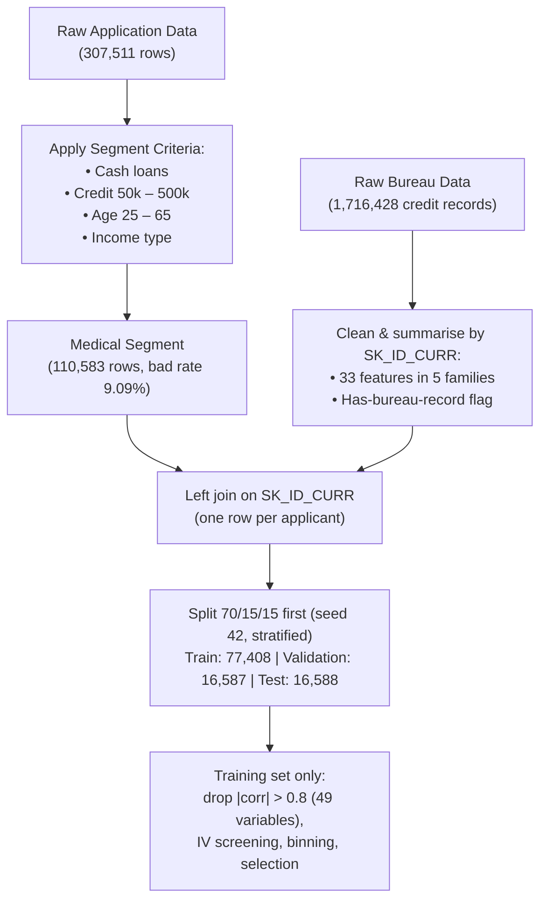

# IS453 Financial Analytics: Credit Scorecard Development
## Project Write-up: Combined Scorecard Notebook
**Academic Term:** IS453 Financial Analytics  
**Course Group:** Section 1, Group 7 (G1 - Group 7)  
**Lending Product Assignment:** **Medical Procedure Loans**  
**Code:** `IS453_G7_Scorecard_Combined.ipynb`  
**Version:** v3 (validation update, see [version labels](#version-labels))

---

## Executive Summary

Group 7 has developed a credit scorecard for a new retail product: **Medical Procedure Loans**, which finance
out-of-pocket elective and semi-urgent medical costs such as dental restoration, fertility treatment, orthopaedic and
corrective surgery. The analysis runs end to end in one notebook and follows the techniques taught in the Week 9–11 labs.

1. **Segment Filtering & Data Integration:** 110,583 representative applications selected from 307,511 records
   (bad rate 9.09%), merged with 1,716,428 bureau credit records cleaned and summarised into 33 features per applicant.
2. **Train / validation / test split (70/15/15):** 77,408 / 16,587 / 16,588 applicants. Screening, binning and variable
   selection use the training set. The model, the cutoff and the pricing checks are chosen on the validation set. The test
   set is used once, to report the final results.
3. **Screening & Grouping:** 104 candidate variables (after removing 49 highly correlated ones) are screened by
   Information Value: **104 → 43 (fine-classing IV ≥ 0.02) → 36 (after coarse classing) → 33 (after WOE redundancy
   screening) → 14 predictors** chosen by forward selection on validation Gini.
4. **Logistic Regression & Discrimination:** on the untouched test set, **AUC 0.7139, Gini 0.4278 and K-S 30.91%**, close
   to the training (AUC 0.7120) and validation (AUC 0.7175) results.
5. **Scaling (Week 11 lab):** **600 points at odds of 19:1 (5% probability of default), PDO = 20**.
6. **Cutoff, Pricing & Profitability:** the profit-maximising cutoff chosen on validation is **570 points**. On the test
   set it approves **78.4%** of applicants and lowers the bad rate among approved applicants from **9.10% to 6.12%**.
   With a single 15% product rate, a 5% cost of funds, 70% loss given default and an assumed **24-month term for every
   loan**, test profit is **226.8m, against 170.3m if everyone were approved**. These are scenario figures, not a forecast.
7. **Pricing:** one product rate of 15% for every approved applicant. Every approved score band breaks even below 15%,
   while the declined band would need about 21%. Score bands set the origination checks, not the rate. Charging each
   band its own indicative rate would cut test profit to 127.2m, so tiered rates are not recommended.

> [!NOTE]
> This version (v3) replaces the group's first version (v1, `credit_scorecard_medical.py`) and the first notebook
> (v2) on the **same segment**. The changes, and the reason for each, are listed in
> [Changes from the First Version](#changes-from-the-first-version) and [Changes from v2 to v3](#changes-from-v2-to-v3).

### Version labels
| Label | What it is | Commit | Where it is |
| :--- | :--- | :---: | :--- |
| **v1** | script `credit_scorecard_medical.py` and its Dossier | `c4582a1` | `archive/v1-script/` |
| **v2** | first notebook and write-up, before the validation split | `a4295cb` | `archive/v2-before-validation-split/` |
| **v3** | validation update plus the later fixes (current version) | `2ec24a8` and later | repository root |

---

## Component 1: Business Opportunity, Customer Segment & Product Context

### 1. The Market Opportunity
Insurance often leaves patients paying part of their medical bills themselves through co-payments, deductibles, claim
limits, or elective procedures that are not covered at all, such as:
- **Dental restoration and implants**
- **IVF and fertility treatment**
- **Elective orthopaedic and joint surgery**
- **Corrective and aesthetic surgery**

These costs arrive as a single, known bill that many patients cannot pay from savings. A fixed-instalment loan is cheaper
than revolving credit cards and predictable to repay. For the bank, demand is relatively steady because medical needs do
not follow the economic cycle closely, the purpose is specific (the amount matches a treatment quote), and partnering with
clinics gives a low-cost channel. Decisions are needed quickly at the clinic, which is where an automated scorecard adds
value.

### 2. How the Segment Uses the Product
- A **one-off cash loan** sized to the treatment cost, repaid in **fixed monthly instalments**.
- **Moderate amounts**: median loan of 284,400, against 540,000 for all cash loans.
- **Larger instalments relative to the loan**: the median loan ÷ instalment ratio (`AMT_CREDIT / AMT_ANNUITY`) is 15.5
  in the segment, against 20.7 for all cash loans. This is a ratio taken from the data, **not the contract term**, which
  the data does not contain.
- Applied for close to the procedure date, often at the clinic.

### 3. Core Business Assumptions
1. **Unsecured instalment loan**, disbursed to the borrower or directly to the healthcare provider.
2. **Proxy segment:** the data has no loan-purpose field, so past cash-loan borrowers who match the filters are assumed to
   behave like future medical-procedure borrowers.
3. **Loss Given Default (LGD) of 70%:** unsecured lending with about 30% recovered.
4. **Product interest rate of 15% APR and cost of funds of 5%** (illustrative, used for the profitability analysis).
5. **Loan term of 24 months for every loan.** The data has no contract term, so the profit analysis assumes 24 months.
   This is a scenario choice, and [Component 6](#6-sensitivity-to-term-and-loss-given-default) shows how the cutoff and
   profit change at 12 and 36 months.
6. **TARGET = 1 (payment difficulties) is treated as a default**, which makes the profit estimates conservative.

---

## Component 2: Data Selection, Preparation & Bureau Merging

### 1. Data Selection Criteria (Week 10 Checkpoint)
- `NAME_CONTRACT_TYPE == 'Cash loans'` (instalment loans, excluding revolving credit).
- `50,000 <= AMT_CREDIT <= 500,000` (typical procedure cost range; excludes very small purchases and property- or car-sized loans).
- `25 <= AGE <= 65` (independent adults with elective or restorative medical needs).
- `NAME_INCOME_TYPE` $\in$ `['Working', 'Commercial associate', 'State servant', 'Pensioner']` (a regular income to repay from).
- Loan annuity known and total income above 0.

`ORGANIZATION_TYPE == 'Medicine'` is not used, because it describes the applicant's employer, not the loan's purpose.

### 2. Checkpoint Comparison Metrics
| Metric | Original Application Dataset | Medical Procedure Loan Segment | Variance / Rationale |
| :--- | :---: | :---: | :--- |
| **Total Rows** | 307,511 | **110,583** | Retains **36.0%** of the data; a robust sample size. |
| **Good Borrowers (0)** | 282,686 (91.93%) | **100,528 (90.91%)** | Most borrowers repay. |
| **Defaulted Borrowers (1)** | 24,825 (8.07%) | **10,055 (9.09%)** | **+1.02 points** in bad rate. |

| Filter step | Rows | Bad rate |
| :--- | :---: | :---: |
| Original data | 307,511 | 8.07% |
| 1. Cash loans | 278,232 | 8.35% |
| 2. + loan amount 50k–500k | 123,413 | 8.96% |
| 3. + age 25–65 | 110,596 | 9.09% |
| 4. + income type | 110,589 | 9.09% |
| 5. + annuity known, income > 0 | **110,583** | **9.09%** |

> [!NOTE]
> The higher bad rate comes mainly from the loan-amount filter. Among cash loans, 250k–500k loans have a 9.93% bad rate,
> while loans above 1m have 5.94%. The segment keeps mid-sized loans and removes the large, safer ones. Within the
> segment, bad rates fall steadily with age, from 12.28% for 25–29 year-olds to 5.56% for 55–65 year-olds.

### 3. Credit Bureau Cleaning & Aggregation
Because the bureau data has one row per credit (a median of 4 and up to 116 per applicant), joining it directly would
repeat applicants and create false extra "bad" rows. Each applicant's credits are therefore summarised into one row
(Option 3 from the data-merging module) and left-joined on `SK_ID_CURR`.

**Cleaning before summarising:**
- 17 records updated **after** the application date dropped (information the bank would not have had).
- 8,418 negative debts and 351 negative limits set to 0.
- Credits in other currencies are flagged (290 for the segment); no exchange rates are provided.

**33 features in five families:**
| Family | Examples |
| :--- | :--- |
| Account counts | total, active, closed, sold or bad-debt credits |
| Delinquency | overdue now, ever overdue, largest amount overdue, prolonged credits |
| Exposure | total and active credit and debt, utilisation, debt-to-credit |
| Credit mix | consumer, card, microloan and secured credits; number of credit types |
| History & recency | history length, months since latest credit, credits opened in the last 12 / 24 months |

**Applicants without bureau history:** counts and totals are set to 0, and ratios are left blank so that they get their
own "Missing" bin. A `HAS_BUREAU` flag is added. These applicants are riskier:

| | Applicants | Share | Bad rate |
| :--- | :---: | :---: | :---: |
| No bureau record | 16,822 | 15.2% | **11.31%** |
| Has bureau record | 93,761 | 84.8% | 8.70% |

### 4. Modelling Table & Train/Validation/Test Split
- **Derived variables:** day counts converted to years; ratios such as the loan ÷ instalment ratio
  (`TERM_MONTHS` = `AMT_CREDIT / AMT_ANNUITY`, **not the contract term**), credit-to-goods, credit-to-income and
  debt-to-income; `DAYS_EMPLOYED = 365243` (pensioners and unemployed) set to missing and flagged.
- **`ORGANIZATION_TYPE`** grouped from 58 values into 35 sectors.
- **Excluded:** `CODE_GENDER` (protected attribute), two raw bureau day-count fields (replaced by year-based versions) and 6 columns with a single value.
- **Train/validation/test split, done before any screening.** The notebook uses `train_test_split` with `random_state=42`
  and stratifies on `TARGET`: 70% training (**77,408**), 15% validation (**16,587**) and 15% test (**16,588**), with bad
  rates of 9.09%, 9.09% and 9.10%. This extends the Week 11 lab's 70/30 split.
- **Why split first (no data leakage):**
  - **Training set:** correlation screening, IV, fine and coarse binning, WOE and forward selection all learn from the
    training set only. The validation and test sets are only scored with the bins and coefficients it produced.
  - **Validation set:** used to choose variables during forward selection, compare model options, choose the cutoff and
    estimate the pricing bands.
  - **Test set:** used once, after the model is locked, to report the final results. No choice depends on it.
- **Highly correlated variables (Week 9 lab):** 118 pairs with |correlation| > 0.8 in the training set; the variable less
  correlated with TARGET is dropped in each pair (49 variables), mostly duplicate building statistics. 104 predictors
  remain.

---

## Component 3: Screening & Grouping of Variables (WoE & IV)

### 1. Screening by Information Value (Week 10 lab)
Each of the 104 candidate variables was fine-classed on the training set into 20 equal-frequency bins (`pd.qcut`),
using the course formulas (with 0.5 added to empty bins to avoid infinite values):
$$\text{WoE}_j = \ln\left( \frac{\% \text{Goods}_j}{\% \text{Bads}_j} \right) \quad \text{and} \quad \text{IV} = \sum_j (\% \text{Goods}_j - \% \text{Bads}_j) \times \text{WoE}_j$$

| IV range | Predictive power | Variables |
| :--- | :--- | :---: |
| < 0.02 | Unpredictive (dropped) | 61 |
| 0.02 – 0.10 | Weak | 38 |
| 0.10 – 0.30 | Medium | 5 |

**43 variables pass.** The strongest are the loan ÷ instalment ratio (0.281), external score `EXT_SOURCE_1` (0.147), years
employed (0.124), bureau debt-to-credit (0.108), share of bureau credits active (0.100), occupation (0.098) and age
(0.098). The full list is in `g7_iv_fine_classing.csv`.

### 2. Coarse Classing (Week 10 & Week 11 labs)
`sc.woebin` groups each variable into coarse bins with at least 5% of applicants each and a separate missing bin. The
notebook's monotonic check flagged **nine** numeric variables whose automatic bins did not show a one-direction trend:
`TERM_MONTHS`, `CREDIT_TO_GOODS`, `AMT_ANNUITY`, `ELEVATORS_AVG`, `BUR_MAX_CREDIT`, `REGION_POPULATION_RELATIVE`,
`NONLIVINGAREA_AVG`, `BUR_N_ACTIVE` and `FLOORSMIN_MEDI`. Adjusted bin edges were then set with `breaks_list`
(Week 10 Ex Q3) for **seven** variables, merging neighbouring bins whose bad rates crossed. Five of the seven come from
the flagged nine; `AMT_CREDIT` and `YEARS_BEGINEXPLUATATION_MEDI` were also given business-based edges:

| Characteristic | Adjusted bin edges | Risk trend |
| :--- | :--- | :--- |
| `CREDIT_TO_GOODS` | 1.14, 1.25 | financing above the procedure price → riskier |
| `AMT_CREDIT` | 110k, 180k, 280k | larger loan → riskier |
| `AMT_ANNUITY` | 13k, 16k | larger instalment → riskier |
| `REGION_POPULATION_RELATIVE` | 0.021, 0.032 | more populated region → safer |
| `YEARS_BEGINEXPLUATATION_MEDI` | 0.977, 0.988 | newer building → safer |
| `BUR_MAX_CREDIT` | 100k, 2.45m | larger past credits elsewhere → safer |
| `TERM_MONTHS` (loan ÷ instalment ratio) | 10.5, 21.5 | **U-shaped** (kept as 3 bins) |

> [!IMPORTANT]
> **The loan ÷ instalment ratio is U-shaped:** below 10.5 the bad rate is 5.1%, from 10.5 to 21.5 it is 11.3%, and at 21.5
> or above it is 5.8%. Within the automatic bins, ratios between 9.5 and 10.5 have only a 2.3% bad rate, which probably
> reflects a standard product. The ratio is the loan amount divided by the monthly instalment, so it hints at repayment
> length, but it is not the contract term and should not be described as a term. The shape is kept (Week 10 DIY Q1
> approach) because forcing one direction would discard most of the strongest variable's information.

Five variables are still not strictly monotonic after adjustment (the four flagged variables that were not adjusted, plus
`TERM_MONTHS`): `TERM_MONTHS` (kept on purpose, see above),
`BUR_N_ACTIVE` (in the final model: bad rates of 8.80%, 8.33%, 9.64% and 13.18% across its four bins, a small dip before
the rise), and `ELEVATORS_AVG`, `NONLIVINGAREA_AVG` and `FLOORSMIN_MEDI` (not in the final model).

After grouping, **36 variables keep IV ≥ 0.02**.

> [!NOTE]
> `scorecardpy` defines WoE as ln(% Bads / % Goods), the opposite sign to the Week 10 formula, so a *positive* WoE
> marks a *riskier* bin and the model's coefficients are positive. The IV is identical.

---

## Component 4: Logistic Regression & Model Performance

### 1. Variable Selection
1. The 36 WoE variables are reduced to **33 candidates**: where two WoE variables have |correlation| > 0.8, the one with
   the higher IV is kept.
2. **Forward selection on validation Gini:** at each step, the variable that raises the **validation** Gini the most is
   added, as long as every coefficient stays above 0.1 (correct sign and a meaningful weight). Selection stops when no
   remaining variable adds at least 0.002, which happened at **14 variables**.

| Step | Variable added | Training Gini | Validation Gini |
| :---: | :--- | :---: | :---: |
| 1 | `BUR_DEBT_TO_CREDIT` | 0.1777 | 0.1946 |
| 2 | `EXT_SOURCE_1` | 0.2605 | 0.2875 |
| 3 | `TERM_MONTHS` | 0.3169 | 0.3330 |
| 4 | `YEARS_EMPLOYED` | 0.3504 | 0.3614 |
| 5 | `BUR_N_ACTIVE` | 0.3592 | 0.3766 |
| 6 | `BUR_SHARE_OVERDUE` | 0.3667 | 0.3865 |
| 7 | `YEARS_PHONE_CHANGE` | 0.3782 | 0.3962 |
| 8 | `REGION_RATING_CLIENT_W_CITY` | 0.3907 | 0.4041 |
| 9 | `NAME_EDUCATION_TYPE` | 0.4014 | 0.4110 |
| 10 | `AMT_CREDIT` | 0.4063 | 0.4176 |
| 11 | `BUR_HISTORY_YEARS` | 0.4106 | 0.4236 |
| 12 | `BUR_N_OPENED_12M` | 0.4167 | 0.4288 |
| 13 | `BUR_UTILISATION` | 0.4228 | 0.4332 |
| 14 | `REG_CITY_NOT_WORK_CITY` | 0.4238 | 0.4352 |

### 2. Model Parameters
`LogisticRegression` on the WoE values (Week 11 lab), trained on 77,408 applicants (training set only):

| Characteristic ($X_i$) | Coefficient ($\beta_i$) | IV (coarse) |
| :--- | :---: | :---: |
| **Intercept ($\beta_0$)** | **-2.3035** | n/a |
| `BUR_DEBT_TO_CREDIT_woe` | 0.2800 | 0.104 |
| `EXT_SOURCE_1_woe` | 0.6838 | 0.141 |
| `TERM_MONTHS_woe` | 0.6879 | 0.134 |
| `YEARS_EMPLOYED_woe` | 0.6575 | 0.122 |
| `BUR_N_ACTIVE_woe` | 1.0612 | 0.021 |
| `BUR_SHARE_OVERDUE_woe` | 0.9405 | 0.039 |
| `YEARS_PHONE_CHANGE_woe` | 0.6317 | 0.057 |
| `REGION_RATING_CLIENT_W_CITY_woe` | 0.8319 | 0.044 |
| `NAME_EDUCATION_TYPE_woe` | 0.9132 | 0.039 |
| `AMT_CREDIT_woe` | 0.7042 | 0.034 |
| `BUR_HISTORY_YEARS_woe` | 0.5350 | 0.081 |
| `BUR_N_OPENED_12M_woe` | 0.7443 | 0.041 |
| `BUR_UTILISATION_woe` | 0.6587 | 0.058 |
| `REG_CITY_NOT_WORK_CITY_woe` | 0.3066 | 0.031 |

> [!IMPORTANT]
> **Key Diagnostic Highlights for Presentation:**
> - **Sign Consistency:** all coefficients are positive, which with `scorecardpy`'s WoE means riskier bins correctly
>   raise the log-odds of default.
> - **Balanced inputs:** 6 application characteristics, 2 loan characteristics (the loan ÷ instalment ratio and the loan
>   amount) and 6 bureau characteristics.

### 3. Discrimination & Model Performance (Train vs Validation vs Test)
| Evaluation Metric | Training Set (70%) | Validation Set (15%) | Test Set (15%) | Interpretation |
| :--- | :---: | :---: | :---: | :--- |
| **ROC - AUC** | 0.7120 | 0.7175 | **0.7139** | Solid discrimination for application data. |
| **Gini** | 0.4240 | 0.4349 | **0.4278** | Similar on all three sets: no sign of overfitting. |
| **Kolmogorov-Smirnov (K-S)** | 31.34% | 31.88% | **30.91%** | On the test set, the widest separation of goods and bads is at score **582**. |

| Calibration | Observed bad rate | Mean predicted probability | Brier score |
| :--- | :---: | :---: | :---: |
| Training | 9.09% | 9.09% | 0.0783 |
| Validation | 9.09% | 9.06% | 0.0779 |
| Test | 9.10% | 9.08% | 0.0781 |

The average predicted probability of default is within 0.03 percentage points of the observed bad rate on every set. On
the validation set, the expected defaults from the scores run slightly above the actual ones at the chosen cutoff
(819 expected against 794 actual at 570, see [Component 6](#3-cutoff-optimisation--profitability-analysis)).

**Reading the ROC curve (left).** The scorecard is used to catch defaulters, so the chart starts from the lowest scores
and works upwards. The y-axis is the share of all defaulters caught so far, and the x-axis is the share of good payers
caught along with them. A useless score would follow the dashed diagonal (catching defaulters no faster than good
payers). The curves bow clearly above it. The **AUC (area under the curve)** sums this up: 0.5 is random, 1.0 is perfect,
and 0.714 on the test set is solid for application data. The training, validation and test curves almost overlap, which
confirms the model is not overfitting.

**Reading the K-S chart (right).** For every score, the blue line is the share of all defaulters scoring at or below it,
and the orange line the share of all good payers. Defaulters pile up at low scores, so the blue line rises first. The
**K-S statistic is the widest vertical gap between the lines: 30.91% on the test set, at score 582**. It is the point of
strongest separation, and it lies 12 points above the chosen cutoff of 570.

*Score distribution of all 110,583 applicants (training, validation and test combined, Week 11 lab). Scores run from 497
to 676.*

---

## Component 5: Model Tuning

Options are compared on the **validation** set (5,739 applicants, bad rate 7.49%). The test set is not used to choose
between them; it is scored once, after the model is locked.

| Option | Variables | Training Gini | Validation Gini | Wrong-sign coefficients | Average predicted PD (validation) |
| :--- | :---: | :---: | :---: | :---: | :---: |
| **Selected variables, automatic `sc.woebin` bins (chosen)** | 14 | 0.4500 | **0.4383** | 0 | 7.59% |
| Selected variables, adjusted monotonic bins | 14 | 0.4332 | 0.4245 | 0 | 7.55% |
| First 5 selected variables | 5 | 0.4010 | 0.3883 | 0 | 7.54% |
| First 10 selected variables | 10 | 0.4329 | 0.4246 | 0 | 7.56% |
| All 32 candidate variables | 32 | 0.4745 | 0.4311 | 5 | 7.59% |
| Selected + `class_weight='balanced'` (Week 9 lab) | 14 | 0.4499 | 0.4382 | 0 | 43.72% |

*Actual validation bad rate: 7.49%. Source: `g7_tuning_validation.csv`.*

**Automatic vs adjusted bins, same 14 predictors (validation):**

| Binning | AUC | Gini | K-S | Brier score | Total bins | Bins under 5% |
| :--- | :---: | :---: | :---: | :---: | :---: | :---: |
| **Automatic (chosen)** | **0.7194** | **0.4387** | **35.06%** | 0.0661 | 62 | 0 |
| Adjusted (monotonic `breaks_list`) | 0.7127 | 0.4253 | 33.01% | 0.0664 | 57 | 0 |

*Source: `g7_binning_comparison_validation.csv`.*

The difference comes almost entirely from **`TERM_MONTHS`** (loan ÷ instalment ratio), whose IV doubles from 0.113 (three
adjusted bins) to 0.227 (five automatic bins). Its automatic bins are not monotonic, but the pattern is stable between
training and validation:

| TERM_MONTHS bin | Training applicants | Training bad rate | Validation bad rate |
| :--- | :---: | :---: | :---: |
| below 9.0 | 1,899 | 9.90% | 8.54% |
| 9.0–9.5 | 3,931 | 5.49% | 6.53% |
| 9.5–10.5 | 4,566 | 2.43% | 2.30% |
| 10.5–13.0 | 4,312 | 12.06% | 12.96% |
| 13.0 and above | 12,076 | 8.07% | 7.68% |

> [!TIP]
> **Tuning Decisions:**
> - **Automatic bins are used in the final model.** They raise validation AUC from 0.7127 to 0.7194 and K-S from 33.0% to
>   35.1% with the same 14 variables, no wrong-sign coefficients and good calibration (7.59% predicted vs 7.49% observed).
> - **Non-monotonic `TERM_MONTHS` bins are kept on purpose.** Forcing a monotonic trend would merge bins with very
>   different risk (2.43% vs 12.06%) and hide risk the data shows. Each bin holds at least 7% of training applicants and
>   the pattern repeats on validation. It is an observed association, not a causal effect (the variable is a loan ÷
>   instalment ratio, not the contract term), so it is flagged for monitoring after launch.
> - **14 variables:** each extra variable adds less; steps 13 and 14 add about 0.002 validation Gini each, and gains
>   flatten after about 10 variables.
> - **All 32 candidate variables** reach the highest training Gini (0.4745) but a lower validation Gini (0.4311) and five
>   wrong-sign coefficients: overfitting, and their points would contradict their own bins.
> - **`class_weight='balanced'`** leaves the ranking unchanged (0.4382) but inflates the average predicted PD to 43.72%
>   (actual 7.49%), which breaks the 600 = 5% PD scaling and the expected-default calculation.

**Impact on the rest of the pipeline:** the locked model scores test AUC 0.7080, Gini 0.4159 and K-S 32.12%, and the
validation profit-maximising cutoff becomes **565** (see Component 6).

---

## Component 6: Scorecard Scaling, Cutoff Selection & Profitability

### 1. Scaling Mathematics (Week 11 lab)
- $\text{Target Score} = 600$ at $\text{odds (bad:good)} = 1:19$, i.e. a 5% probability of default; $\text{PDO} = 20$.
- $\text{Factor} = \frac{\text{PDO}}{\ln(2)} = \frac{20}{0.69315} = \mathbf{28.8539}$.
- $\text{Offset} = 600 + \text{Factor} \times \ln(1/19) = 600 - 28.8539 \times 2.94444 = \mathbf{515.0414}$.
- Built with `sc.scorecard(bins, lr, ..., points0=600, odds0=1/19, pdo=20, basepoints_eq0=True)`, which spreads the
  base points across the 14 characteristics. Scores range from 497 to 676.

### 2. Complete Scorecard Points Table
Share of applicants and bad rate are from the training set. The full table is saved as `g7_final_bins_and_points.csv`.

| Characteristic | Attribute | Share of applicants | Bad rate | Points |
| :--- | :--- | :---: | :---: | :---: |
| **Bureau debt-to-credit (`BUR_DEBT_TO_CREDIT`)** | Missing (no bureau record) | 15.6% | 11.3% | **40** |
|  | < 0.15 | 37.5% | 6.5% | **44** |
|  | 0.15 – 0.4 | 19.9% | 7.8% | **43** |
|  | 0.4 – 0.65 | 15.4% | 10.5% | **40** |
|  | ≥ 0.65 | 11.7% | 14.7% | **37** |
| **External score (`EXT_SOURCE_1`)** | Missing | 57.2% | 9.6% | **40** |
|  | < 0.22 | 5.3% | 17.7% | **26** |
|  | 0.22 – 0.42 | 12.6% | 10.9% | **37** |
|  | 0.42 – 0.5 | 5.3% | 7.5% | **46** |
|  | 0.5 – 0.64 | 8.6% | 5.9% | **51** |
|  | ≥ 0.64 | 10.9% | 3.6% | **61** |
| **Loan ÷ instalment ratio (`TERM_MONTHS`)** | < 10.5 | 21.4% | 5.1% | **54** |
|  | 10.5 – 21.5 | 63.2% | 11.3% | **37** |
|  | ≥ 21.5 | 15.4% | 5.8% | **51** |
| **Years employed (`YEARS_EMPLOYED`)** | Missing (pensioner / not employed) | 18.0% | 5.6% | **52** |
|  | < 4 | 38.4% | 12.1% | **35** |
|  | 4 – 5.5 | 10.1% | 10.6% | **38** |
|  | 5.5 – 11 | 20.6% | 8.0% | **44** |
|  | ≥ 11 | 13.0% | 5.6% | **52** |
| **Active bureau credits (`BUR_N_ACTIVE`)** | < 1 | 31.1% | 8.8% | **43** |
|  | 1 – 3 | 42.7% | 8.3% | **44** |
|  | 3 – 5 | 18.5% | 9.6% | **40** |
|  | ≥ 5 | 7.7% | 13.2% | **29** |
| **Share of bureau credits ever overdue (`BUR_SHARE_OVERDUE`)** | Missing (no bureau record) | 15.3% | 11.3% | **35** |
|  | < 0.01 | 61.1% | 8.0% | **46** |
|  | 0.01 – 0.19 | 9.5% | 9.0% | **42** |
|  | 0.19 – 0.34 | 8.6% | 10.5% | **37** |
|  | ≥ 0.34 | 5.5% | 13.7% | **29** |
| **Years since phone change (`YEARS_PHONE_CHANGE`)** | < 1.8 | 46.7% | 10.9% | **38** |
|  | 1.8 – 3.4 | 19.5% | 9.1% | **42** |
|  | 3.4 – 4.8 | 15.6% | 7.2% | **46** |
|  | ≥ 4.8 | 18.3% | 6.1% | **49** |
| **Region rating (`REGION_RATING_CLIENT_W_CITY`)** | < 2 | 7.6% | 5.6% | **54** |
|  | 2 – 3 | 77.2% | 8.7% | **43** |
|  | ≥ 3 | 15.2% | 12.8% | **32** |
| **Education (`NAME_EDUCATION_TYPE`)** | Academic degree, Higher education | 20.1% | 6.0% | **53** |
|  | Incomplete higher, Secondary / secondary special, Lower secondary | 79.9% | 9.9% | **39** |
| **Loan amount (`AMT_CREDIT`)** | < 110,000 | 5.9% | 5.6% | **52** |
|  | 110,000 – 180,000 | 11.8% | 6.8% | **48** |
|  | 180,000 – 280,000 | 29.8% | 8.7% | **43** |
|  | ≥ 280,000 | 52.5% | 10.2% | **39** |
| **Years of bureau history (`BUR_HISTORY_YEARS`)** | Missing (no bureau record) | 15.3% | 11.3% | **38** |
|  | < 2 | 13.9% | 13.1% | **35** |
|  | 2 – 4 | 19.6% | 9.9% | **40** |
|  | 4 – 6.2 | 18.8% | 8.0% | **44** |
|  | ≥ 6.2 | 32.5% | 6.5% | **47** |
| **Credits opened in last 12 months (`BUR_N_OPENED_12M`)** | < 1 | 50.4% | 8.1% | **44** |
|  | 1 – 2 | 26.1% | 8.5% | **43** |
|  | 2 – 3 | 13.1% | 10.2% | **39** |
|  | ≥ 3 | 10.4% | 14.0% | **31** |
| **Bureau utilisation (`BUR_UTILISATION`)** | Missing (no active credit limit) | 32.1% | 8.8% | **42** |
|  | < 0.75 | 44.4% | 7.5% | **46** |
|  | 0.75 – 0.95 | 16.8% | 11.5% | **36** |
|  | ≥ 0.95 | 6.7% | 14.9% | **31** |
| **Registered city differs from work city (`REG_CITY_NOT_WORK_CITY`)** | < 1 | 76.0% | 8.2% | **42** |
|  | ≥ 1 | 24.0% | 11.8% | **39** |

### 3. Cutoff Optimisation & Profitability Analysis
*Profit per good loan = interest at 15% APR minus 5% cost of funds, over an assumed 24-month term, on the applicant's
own loan amount. Loss per bad loan = 70% of the loan amount. The cutoff is chosen on the validation set and reported on
the test set.*

**Expected and actual defaults on the validation set** (16,587 applicants). Expected defaults use odds (good:bad) =
19 × 2^((score − 600)/20), as in the Week 11 lab:

| Cutoff Score | Approval Rate (%) | Expected Defaults | Actual Defaults | Bad Rate in Approved (%) |
| :---: | :---: | :---: | :---: | :---: |
| 550 | 95.5% | 1,304 | 1,287 | 8.12% |
| 560 | 88.7% | 1,078 | 1,059 | 7.20% |
| **570 (Chosen)** | **78.4%** | **819** | **794** | **6.10%** |
| 580 | 64.3% | 554 | 548 | 5.14% |
| 590 | 48.2% | 333 | 309 | 3.87% |
| 600 | 32.1% | 173 | 167 | 3.13% |

**Profit at every cutoff** (test set, 16,588 applicants; amounts in millions of the data's currency; 15% APR, 24-month term):

| Cutoff Score | Approval Rate (%) | Approved Loans | Defaulted Loans | Bad Rate in Approved (%) | Net Interest from Good Loans | Default Losses | **Net Profit** |
| :---: | :---: | :---: | :---: | :---: | :---: | :---: | :---: |
| Approve all | 100.0% | 16,588 | 1,509 | 9.10% | 496.0 | 325.8 | **170.3** |
| 540 | 98.6% | 16,363 | 1,438 | 8.79% | 490.1 | 308.4 | **181.7** |
| 550 | 95.7% | 15,873 | 1,303 | 8.21% | 477.0 | 277.5 | **199.5** |
| 560 | 88.5% | 14,685 | 1,060 | 7.22% | 442.7 | 222.4 | **220.3** |
| **570 (Chosen)** | **78.4%** | **13,002** | **796** | **6.12%** | **392.3** | **165.5** | **226.8** |
| 580 | 64.0% | 10,615 | 550 | 5.18% | 317.9 | 110.0 | **207.8** |
| 590 | 48.1% | 7,974 | 313 | 3.93% | 236.7 | 60.2 | **176.5** |
| 600 | 32.1% | 5,318 | 160 | 3.01% | 154.8 | 29.6 | **125.1** |
| 610 | 18.9% | 3,134 | 87 | 2.78% | 89.0 | 16.1 | **72.9** |
| 620 | 9.7% | 1,613 | 37 | 2.29% | 43.9 | 5.9 | **38.0** |
| 630 | 4.2% | 703 | 11 | 1.56% | 18.4 | 1.9 | **16.5** |

*Profit by cutoff for the training, validation and test sets, each scaled up to the full applicant base. The dashed line
marks the validation-chosen cutoff of 570. The test curve is for final evaluation only.*

**How to read it.** "Net interest from good loans" is the interest earned on approved loans that are repaid, after the
bank's own funding cost. "Default losses" are 70% of each approved loan that defaults. Raising the cutoff removes bad
loans faster than good ones at first, so losses fall more than interest and profit rises. Past 570, the scorecard starts
turning away mostly good payers, so interest falls faster than losses and profit drops. Approving everyone still makes a
profit under these assumptions, but default losses take back about two thirds of the interest earned (325.8m of 496.0m).

> [!TIP]
> **Executive Trade-off:** with a 70% loss on each default, a cutoff of 570 raises test profit from 170.3m to 226.8m (about
> 33% higher) and lowers the bad rate among approved applicants from 9.10% to 6.12%, at the cost of declining about one
> in five applicants. If the bank prioritises market share, a cutoff of 560 approves 88.5% of applicants for 220.3m.

### 4. Confusion Matrix at Recommended Cutoff (570)
*Evaluation on 16,588 test applicants (Positive = Good Repayer, Negative = Defaulter), as in the Week 11 lab:*

| | **Predicted Good (Score $\ge 570$)** | **Predicted Defaulter (Score $< 570$)** | Total |
| :--- | :---: | :---: | :---: |
| **Actual Good (0)** | **12,206 (TP)** | 2,873 (FN) | 15,079 |
| **Actual Defaulter (1)** | 796 (FP) | **713 (TN)** | 1,509 |
| **Total** | 13,002 | 3,586 | 16,588 |

| Measure | Value | Meaning |
| :--- | :---: | :--- |
| **Accuracy** | **77.88%** | share of applicants classified correctly |
| **Error Rate** | **22.12%** | share classified wrongly (1 − accuracy) |
| **Sensitivity / Recall (goods)** | **80.95%** | share of good payers who are approved |
| **Specificity (defaulters)** | **47.25%** | share of defaulters declined before receiving a loan |
| **Precision** | **93.88%** | share of approved applicants who repay |
| **F-1 Score (goods)** | **86.93%** | balance of precision and recall: 2 × P × R / (P + R) |

> [!NOTE]
> Accuracy (78%) is lower than simply approving everyone would give (91%, since 91% of applicants repay). The cutoff is
> chosen to maximise profit, not accuracy. A missed defaulter costs 70% of the loan, while a declined good payer costs
> only the lost interest, so the scorecard deliberately declines some good payers to avoid defaulters. The F-1 score of
> 0.87 reflects this trade-off: precision is high (94%), but about one in five good payers is declined and fewer than half
> of defaulters (47%) are caught.

### 5. Interest Rate and Pricing (Recommended Approach)
**Recommendation: charge one product rate of 15% APR to every approved applicant.**

Score bands are used to set the **origination checks**, not the interest rate. The break-even APR is the lowest rate at
which a band's interest covers its default losses and the cost of funds. It is estimated on the **validation** set
(16,587 applicants, 24-month term, 70% LGD):

| Tier | Score range | Applicants (validation) | Bad rate | Break-even APR | Origination checks | Rate charged |
| :--- | :---: | :---: | :---: | :---: | :--- | :---: |
| **Tier 1 (Prime)** | ≥ 630 | 743 | 1.48% | 6.0% | Approve with standard documents; verify clinic before direct payment | 15% |
| **Tier 2 (Near prime)** | 610 – 629 | 2,410 | 2.53% | 6.8% | Approve with standard documents and verified clinic quote | 15% |
| **Tier 3 (Standard)** | 590 – 609 | 4,839 | 4.90% | 8.3% | Approve after income and clinic-plan checks | 15% |
| **Tier 4 (Higher risk)** | 570 – 589 | 5,018 | 9.67% | 12.0% | Approve after full income and verified clinic-plan review | 15% |
| **Decline** | < 570 | 3,577 | 19.96% | 20.9% | Decline, or refer for a co-signer or security | Declined |

- **Every approved band breaks even below 15%.** The highest approved break-even rate is 12.0% (Tier 4), so the 15%
  product rate covers every approved band's losses and funding cost.
- **The declined band needs about 21%** (20.9%) just to break even, well above the 15% product rate, which is why
  applicants below 570 are declined.
- **Origination checks** increase as the score falls. The best bands are approved with standard documents, which suits a
  decision made at the clinic; Tier 4 gets a full income and clinic-plan review because its bad rate (9.67%) is closest
  to the decline band.
- **The tiers change the checks, not the rate.**

**Why not price each tier separately?** An indicative rate for each tier is its break-even APR plus a 3-point margin,
rounded up to the nearest 0.5%: 9.0% for Tier 1, 10.0% for Tier 2, 11.5% for Tier 3 and 15.0% for Tier 4. If each tier
paid its indicative rate instead of 15%, test profit at cutoff 570 would fall to **127.2m**, which is below the **170.3m**
from approving everyone at 15%, and well below the **226.8m** from a single 15% rate at the same cutoff. Tiered rates are
therefore not recommended. The margin is a business decision, and the break-even rates are estimated on the validation
set, so they are a scenario and not a market-ready price list.

### 6. Sensitivity to Term and Loss Given Default
The data has no contract term, so the profit analysis assumes 24 months and a 70% LGD. The table re-runs the cutoff
search on the **validation** set for other terms and loss rates (profit in millions, validation set only, so not
comparable with the test figures above):

| Term (months) | LGD | Best cutoff (validation) | Profit at cutoff 570 (m) | Maximum profit (m) |
| :---: | :---: | :---: | :---: | :---: |
| 12 | 50% | 585 | 76.9 | 80.1 |
| 12 | 70% | 590 | 28.5 | 57.1 |
| 12 | 90% | 595 | -19.8 | 39.9 |
| 24 | 50% | 560 | 271.5 | 279.5 |
| **24** | **70%** | **570** | **223.2** | **223.2** |
| 24 | 90% | 570 | 174.9 | 174.9 |
| 36 | 50% | 550 | 477.7 | 524.3 |
| 36 | 70% | 555 | 429.4 | 448.8 |
| 36 | 90% | 565 | 381.1 | 383.2 |

*Bold row: the base case used throughout (24 months, LGD 70%).*

**What it means for the cutoff.** At the 24-month base case the profit-maximising cutoff is **570**, and it stays at 570
if LGD rises to 90% (560 if LGD is 50%). Across the nine scenarios the best cutoff ranges from **550** (36 months, LGD
50%) to **595** (12 months, LGD 90%). Shorter terms and higher loss rates push the cutoff up, because there is less
interest to cover each default; longer terms pull it down. Keeping 570 in every scenario gives up nothing at the
24-month base case with LGD 70% or 90%, and up to 46.6m at 36 months with LGD 50%. It gives up most at 12 months: with
LGD 70%, 570 earns 28.5m against 57.1m at the best cutoff (590), and with LGD 90% it makes a loss of 19.8m against a best
profit of 39.9m (at 595). The level of profit depends heavily on the
term: with LGD 70%, validation profit at 570 is 28.5m at 12 months, 223.2m at 24 months and 429.4m at 36 months. The
24-month figure should therefore be read as a scenario, and the term should be confirmed with the product team before the
profit numbers are quoted as targets.

---

## Component 7: Scorecard Walkthrough with Example Applicants

Three real test-set applicants at the 10th, 50th and 90th percentile of score, scored with `sc.scorecard_ply` (Week 11
Ex Q1 style). The notebook checks that each point total matches the scoring pipeline.

| Characteristic | Applicant 177312 | Pts | Applicant 297073 | Pts | Applicant 365037 | Pts |
| :--- | :--- | :---: | :--- | :---: | :--- | :---: |
| Bureau debt-to-credit | 0.38 | 43 | 0.76 | 37 | 0.58 | 40 |
| External score | Missing | 40 | Missing | 40 | 0.82 | 61 |
| Loan ÷ instalment ratio | 16.46 | 37 | 26.30 | 51 | 22.47 | 51 |
| Years employed | 0.32 | 35 | 0.11 | 35 | Missing | 52 |
| Active bureau credits | 6 | 29 | 2 | 44 | 5 | 29 |
| Share of bureau credits ever overdue | 0 | 46 | 0 | 46 | 0.14 | 42 |
| Years since phone change | 4.29 | 46 | 4.08 | 46 | 6.74 | 49 |
| Region rating | 3 | 32 | 2 | 43 | 2 | 43 |
| Education | Secondary / secondary special | 39 | Secondary / secondary special | 39 | Secondary / secondary special | 39 |
| Loan amount | 387,000 | 39 | 392,427 | 39 | 286,704 | 39 |
| Years of bureau history | 5.52 | 44 | 7.05 | 47 | 6.86 | 47 |
| Credits opened in last 12 months | 1 | 43 | 1 | 43 | 2 | 39 |
| Bureau utilisation | 0.59 | 46 | 0.93 | 36 | 0.72 | 46 |
| Registered city differs from work city | 1 | 39 | 0 | 42 | 0 | 42 |
| **Total Score** | **558** | | **588** | | **619** |
| **Decision** | **Decline** | | **Approve (Tier 4 checks)** | | **Approve (Tier 2 checks)** |

- **Applicant 177312 (558, declined):** under four months in the current job (35 points), the worst region rating
  (32), six active bureau credits (29) and no external score (40) pull the total below the cutoff. This applicant
  actually repaid, an example of a good payer turned away by the cutoff.
- **Applicant 297073 (588, approved with Tier 4 checks):** a loan ÷ instalment ratio of 26.3 (51 points) lifts a score
  that is otherwise held down by very short employment (35) and a missing external score (40). It clears the cutoff by
  18 points and repaid.
- **Applicant 365037 (619, approved with Tier 2 checks):** a high external score of 0.82 (61 points) and a ratio of
  22.5 (51 points) outweigh five active bureau credits (29 points). This applicant repaid.

---

## Changes from the First Version

The segment is unchanged. The table summarises what changed from the first version (v1, `credit_scorecard_medical.py`)
to the current version (v3) and why.

| # | Area | First version (v1) | This version (v3) | Reason |
| :---: | :--- | :--- | :--- | :--- |
| 1 | Code | Python script | notebook following the Week 9–11 labs | matches the techniques taught; each step can be explained against the labs |
| 2 | Bureau cleaning | not applied | post-application records dropped, negative amounts set to 0, foreign currency flagged | negative debts would make applicants look safer; later records are leakage |
| 3 | Bureau features | 7 summaries | 33 features + `HAS_BUREAU` | adds signals now in the model: bureau history, recent credits, share of overdue and active credits |
| 4 | No bureau record | debt ratio became 0, placing them in the lowest-debt bin (73 points) | ratio left blank, own Missing bin (40 points vs 44 for the lowest-debt bin) | these applicants are riskier (11.31% vs 8.70%) |
| 5 | Screening | IV reported for 8 selected variables | Week 9 correlation rule, then IV for all 104 candidates (43 pass) | the brief asks for screening of the available variables (Week 10 lab) |
| 6 | Binning | fixed bin edges; payment-rate points 68 / 70 / 61 / 79 | `sc.woebin` + `breaks_list`; monotonic except the explained U-shape and `BUR_N_ACTIVE` | one-direction bins are easier to justify and more stable |
| 7 | Variable selection | fixed set of 8 | forward selection on validation Gini, 14 variables, coefficient rule | adds predictive variables while keeping every coefficient meaningful |
| 8 | Model fitting | statsmodels coefficients reported, sklearn coefficients used for points | one sklearn `LogisticRegression` | reported and applied coefficients are the same |
| 9 | Scaling | 600 = 50:1 | 600 = 19:1 (5% PD) | matches the Week 11 lab (`odds0 = 1/19`); scores are not comparable between versions |
| 10 | Split | `train_test_split` (train/test) | 70/15/15 train/validation/test, done before screening | no leakage: choices use training and validation data, test is used once |
| 11 | Performance | AUC 0.684, K-S 26.9% | test AUC 0.7139, Gini 0.4278, K-S 30.91%, calibration and PCC measures | better discrimination and calibration checks taught in Week 11 |
| 12 | Tuning | none | 6 options compared on validation | the brief asks for the tuning approach and results |
| 13 | Profit | average loan of 250,000, 18% margin, 10,000-applicant cohort | each loan's own amount, fixed 24-month term, 15% APR less 5% funding, 70% LGD | links profit to an interest rate and to each applicant's loan |
| 14 | Pricing | 3 tiers at 6.5% / 8.5% / 12% | one 15% product rate; score bands set the origination checks | tiered rates would cut test profit to 127.2m, below approving everyone (170.3m) |
| 15 | Examples | 3 illustrative profiles | 3 real test applicants | shows the scorecard on actual data values |
| 16 | Consistency | some dossier tables differed from the script's outputs | every number from one notebook run, with audit checks | one consistent set of results |
| 17 | Leakage control | not separated | screening, binning and selection on training only; model, cutoff and pricing on validation; test used once | test results are an honest estimate for new applicants |
| 18 | Term assumption | not stated | 24 months for every loan, with a 12 / 24 / 36-month sensitivity table | the data has no contract term; the loan ÷ instalment ratio is not a term |

### Explanation of the Changes

**Lab-style notebook**
- **What:** the whole analysis runs in one notebook using the same tools as the Week 9–11 labs.
- **Why:** the brief requires the techniques taught in the course. Matching the lab code makes each step easy to
  recognise and easy for every member to explain.

**Bureau data cleaned and expanded (7 → 33 features)**
- **What:** before each applicant's credits at other lenders are summarised, impossible values (negative debts) are set
  to 0 and records dated after the application are removed. The summary now covers counts, overdue history, debt levels,
  types of credit and recent borrowing.
- **Why:** negative debts would make applicants look safer than they are, and information from after the application
  was not available when the bank decided (leakage). The extra features add useful signals to the model, such as recent
  credits and past overdue amounts.

**Applicants with no bureau record**
- **What:** they now get their own "Missing" group.
- **Why:** previously their debt ratio worked out to 0, which placed them in the lowest-debt, best-scoring group. They
  are in fact riskier (11.3% bad rate vs 8.7%), so they should score lower, and now they do.

**All variables screened by IV**
- **What:** all 104 candidate variables are tested for how well they separate goods from bads, after removing
  near-duplicate variables (Week 9).
- **Why:** the brief asks for screening of the available variables. Testing them all shows why each one was kept or
  dropped, and it found strong variables not used before, such as the loan ÷ instalment ratio.

**Binning with `sc.woebin`, adjusted to one direction**
- **What:** variables are grouped into bins automatically, then neighbouring bins are merged where risk went up and down.
- **Why:** a pattern that rises or falls steadily is easier to justify (for example, longer employment → safer). The loan
  ÷ instalment ratio is genuinely U-shaped, so it is kept that way with an explanation.

**14-variable model chosen step by step on validation Gini**
- **What:** variables are added one at a time, keeping whichever improves the validation Gini most. Any step that gives a
  variable the wrong sign or almost no weight is rejected, and selection stops when the gain falls below 0.002.
- **Why:** this adds the most useful information while keeping every variable meaningful and explainable, and it avoids
  choosing variables by looking at the test set.

**Scaling changed to 600 = 19:1**
- **What:** a score of 600 now means odds of 19 goods to 1 bad (a 5% chance of default), and every 20 points doubles the odds.
- **Why:** this is the setting used in the Week 11 lab. Scores from the two versions cannot be compared directly.

**Better performance (test AUC 0.714, K-S 30.9%)**
- **What:** the new model separates goods from bads better than the first version (AUC 0.684, K-S 26.9%), and it checks
  that the average predicted probability matches the actual bad rate.
- **Why:** the gain comes from the richer bureau features and the wider set of variables. Because predicted and actual
  bad rates match closely, the scores can be trusted as probabilities.

**Train / validation / test split and the leakage fix**
- **What:** the data is split 70/15/15 before any screening. Training data builds the bins and the model, validation data
  makes every choice, and the test set is used once at the end.
- **Why:** in v2, the tuning section stated that the test Gini decided between model options, and the cutoff was
  checked on the same test set that reported the results, so the test figures were not fully independent. v3 keeps the
  test set clean.

**Profit model based on each applicant's own loan, with a fixed 24-month term**
- **What:** profit is calculated loan by loan: interest at 15% minus the 5% funding cost on good loans, and 70% of the
  loan lost on bad loans, with every loan assumed to run 24 months.
- **Why:** the first version used one average loan size and a flat margin not tied to an interest rate. The loan ÷
  instalment ratio from the data is not a contract term, so a fixed, stated term is more honest, and the sensitivity
  table shows what happens if it is wrong.

**Cutoff of 570**
- **What:** applicants scoring 570 or more are approved: 78.4% of test applicants, with a bad rate of 6.12%.
- **Why:** 570 gives the highest profit on the validation set, and the test set agrees (226.8m, the highest of the
  cutoffs shown in the table). A lower cutoff is an option if the bank prefers more customers over profit.

**One product rate, with score bands setting the origination checks**
- **What:** every approved applicant pays 15%. Each score band's break-even rate is used to confirm that the band is
  covered, and each band has its own approval process: standard documents for the best bands, extra checks for riskier ones.
- **Why:** every approved band breaks even below 15%, and charging each band its own indicative rate would cut test profit
  to 127.2m, below approving everyone at 15% (170.3m).

**Audit checks**
- **What:** the notebook asserts that the merge keeps one row per applicant and the same bads, that screening used only
  training data, that every scorecard bin has points, that the example applicants' totals match the scoring pipeline, that
  scoring needs only the 14 final predictors, and that the final cutoff and test accounting are consistent.
- **Why:** each check stops the notebook if something silently goes wrong, so the reported numbers can be trusted.

**Additions**
- **Tuning comparison:** shows the final model was chosen over the alternatives for clear reasons.
- **Profit at every cutoff and the term and LGD sensitivity:** show the trade-off between approving more applicants and
  losing more to defaults, and how much depends on the assumptions.
- **Error rate, specificity and F-1:** fuller measures of the cutoff's decisions, explaining why accuracy is deliberately
  lower than approving everyone.
- **Charts:** ROC/K-S, score distribution and profit curve, ready for the slides.
- **Real applicant examples:** show the scorecard working on actual data.

### Changes from v2 to v3

v2 is the first notebook and write-up (commit `a4295cb`, kept in `archive/v2-before-validation-split/`). v3 is the
validation update (commit `2ec24a8`) plus the later fixes. The segment is unchanged.

| Item | v2 | v3 |
| :--- | :--- | :--- |
| Split | 70/30 with `sc.split_df`: 77,408 train, 33,175 test | 70/15/15: 77,408 train, 16,587 validation, 16,588 test |
| Highly correlated variables removed | 48 (117 pairs) | 49 (118 pairs) |
| Candidate variables | 105 | 104 |
| Screening funnel | 105 → 41 → 37 → 34 → 15 | 104 → 43 → 36 → 33 → 14 |
| Variable selection | training Gini | validation Gini |
| Test AUC / Gini / K-S | 0.7072 / 0.4144 / 30.47% | 0.7139 / 0.4278 / 30.91% |
| Train AUC / Gini / K-S | 0.7166 / 0.4333 / 32.14% | 0.7120 / 0.4240 / 31.34% |
| Cutoff | 580, chosen on the training set | 570, chosen on the validation set |
| Test approval rate | 64.8% | 78.4% |
| Bad rate among approved (test) | 5.21% | 6.12% |
| Test profit at the cutoff | 233.2m | 226.8m |
| Test profit approving everyone | 49.8m | 170.3m |
| Loan term in the profit model | each loan's loan ÷ instalment ratio | 24 months for every loan |
| Pricing | four tiers with indicative rates of 10.0% to 15.0%, estimated on the test set | one 15% rate; bands from the validation set set the checks |
| Score range | 498 to 684 | 497 to 676 |
| Example applicants (scores) | 558 / 589 / 622 | 558 / 588 / 619 |

The profit figures are not directly comparable: the term assumption changed from each loan's ratio to a fixed 24 months,
and the 570 cutoff approves more applicants. The v2 numbers are kept for reference only and should not be used on slides.

---

## Limitations & Risks
- **Proxy segment:** nothing in the data identifies medical-procedure loans.
- **Higher-risk segment:** 9.09% bad rate against 8.07% overall, driven by mid-sized loans and younger borrowers.
- **Term assumption:** the data has no contract term, so every loan is assumed to run 24 months. Profit depends heavily on
  it: with LGD 70%, validation profit at cutoff 570 is 28.5m at 12 months, 223.2m at 24 months and 429.4m at 36 months,
  and the best cutoff moves between 550 and 595 across the term and LGD scenarios tested. Treat the profit figures as
  scenarios, and confirm the term before quoting them.
- **External score missing for 57%** of applicants, and it is a score the bank cannot explain.
- **No reject inference:** outcomes are only known for previously approved applicants.
- **The loan ÷ instalment ratio is U-shaped** and is not a contract term. It may partly reflect the bank's past product and
  pricing choices rather than borrower risk.
- **Profit figures depend on the assumptions** (APR, cost of funds, LGD, term) and are measured on the 15% test set.
- **Tiered pricing is not supported:** pricing each band at break-even plus a 3-point margin lowers test profit to 127.2m.
  The break-even rates are estimated on one validation set and are not market-tested prices.
- **Fairness:** gender is excluded, but education and the region rating (both among the 14 predictors) could act as proxies and
  should be reviewed.
- **Monitoring:** the score distribution should be tracked after launch (population stability) and the model refreshed if it drifts.

---

## 15-Minute Final Presentation Slide Deck Structure
*(File to submit: `G1 - Group 7 Presentation.pdf`, with section and group number on the title slide. No code or
screenshots on the slides.)*

| Slide # | Slide Title | Visual Assets to Use | Time & Core Message | Speaker |
| :---: | :--- | :--- | :--- | :---: |
| **1** | **Title:** Credit Scorecard for Medical Procedure Loans | Section 1, Group 7; team names | 0:15: Team and project mission. | 1 |
| **2** | **Business Opportunity & Product** | Simple patient → clinic → bank financing diagram; 3 product facts (one-off cost, fixed instalments, decision at the clinic) | 1:15: Why patients need financing, how they use the loan, key business assumptions (unsecured, 70% LGD, proxy segment, 24-month term assumed). | 1 |
| **3** | **Segment Selection & Checkpoint** | Funnel 307,511 → 110,583; checkpoint table; loan-size bad-rate bars | 1:10: The five filters and why; bad rate 9.09% vs 8.07%, driven by mid-sized loans and younger borrowers. | 2 |
| **4** | **Bureau Integration & Data Preparation** | One-to-many → one-row diagram; 5 feature families; thin-file table (11.31% vs 8.70%) | 1:05: Option 3 merge, cleaning (leakage, negative debts), no-bureau applicants kept as their own group; 70/15/15 split (77,408 / 16,587 / 16,588) with all learning on the training set. | 2 |
| **5** | **Variable Screening (IV)** | IV bar chart of the top variables with the 0.02 / 0.1 / 0.3 bands; funnel 104 → 43 → 36 → 33 → 14 | 1:00: 104 candidates screened, 43 pass; the strongest predictors and what they mean. | 3 |
| **6** | **Grouping & the Loan-Ratio Pattern** | WoE chart for one monotonic variable (e.g. years employed) and the U-shaped loan ÷ instalment ratio | 1:10: Coarse classing with at least 5% per bin, one-direction trends, and why the U-shape is kept (it is a ratio, not the contract term). | 3 |
| **7** | **Logistic Regression & Variable Selection** | Forward-selection path (validation Gini by step); coefficient table | 1:00: 14 variables chosen on validation Gini, all coefficients correct sign; mix of application, loan and bureau characteristics. | 4 |
| **8** | **Model Performance** | ROC and K-S chart (`g7_roc_ks_curves.png`); train / validation / test table (test AUC 0.7139, Gini 0.4278, K-S 30.91%) | 1:00: Solid discrimination, small gaps between the three sets, well-calibrated scores. | 4 |
| **9** | **Model Tuning** | Tuning comparison table (6 options, validation Gini) | 0:50: Why 14 variables, adjusted bins and no class weighting were chosen. | 4 |
| **10** | **Scorecard Scaling & Points** | Scaling formula (600 = 19:1, PDO 20); excerpt of the points table (3–4 characteristics) | 0:50: How log-odds become additive points; how to read the scorecard. | 5 |
| **11** | **Cutoff & Profitability** | Profit curve (`g7_profit_curve.png`); profit-by-cutoff table; confusion matrix with accuracy, error rate and F-1 | 1:15: Cutoff 570 chosen on validation: 78.4% approved, bad rate 6.12%, test profit 226.8m vs 170.3m approve-all (15% APR, 24-month term); the market-share trade-off; the term sensitivity (cutoff 550 to 595). | 5 |
| **12** | **Pricing: One 15% Rate, Tiered Checks** | Score-band table with applicants, bad rate, break-even APR and origination checks | 1:00: Every approved band breaks even below 15%; below 570 needs about 21%, so decline; the bands set the checks, not the rate; tiered rates would cut test profit to 127.2m. | 5 |
| **13** | **Scorecard Walkthrough** | Side-by-side points for the three applicants (558 / 588 / 619) | 1:15: Scoring real applicants step by step; the declined applicant who repaid shows the cost of a cutoff. | 6 |
| **14** | **Limitations, Risks & Conclusion** | Short checklist: proxy segment, 24-month term assumption, missing external score, no reject inference, fairness review, monitoring | 0:50: What to watch after launch; recommendation to adopt the scorecard. | 6 / Team |
| **15** | **References** | Course materials (Week 9–11 labs, assignment brief), the provided application and bureau datasets, and the software libraries used (versions in `requirements.txt`); add any other source the group cites | 0:10: Required by the brief; stays on screen while questions begin. | 6 |

> [!TIP]
> Planned speaking time is **14:05**, leaving about 55 seconds for transitions within the 15-minute limit. Each member
> presents at least one component, as the brief requires. Charts come from the notebook (WoE plots, score
> distribution, profit curve) or can be redrawn from the tables in this write-up.

---

## Reproducing the Results

1. Place `IS453 Group Assignment - Application Data.csv` and `IS453 Group Assignment - Bureau Data.csv` in the same
   folder as `IS453_G7_Scorecard_Combined.ipynb`.
2. Create a virtual environment with **Python 3.11 or 3.12** (not 3.13) and install `requirements.txt`:
   `py -3.11 -m venv .venv`, then `.venv\Scripts\Activate.ps1` and `python -m pip install -r requirements.txt` on
   Windows (`python3.11 -m venv .venv`, then `source .venv/bin/activate` and the same `pip install` on Mac).
3. With `.venv` **activated**, run all cells from the command line:
   `python -m nbconvert --to notebook --execute --inplace IS453_G7_Scorecard_Combined.ipynb --ExecutePreprocessor.timeout=3600`.
   Activating puts `.venv` first on `PATH`, so Jupyter and the kernel both come from `.venv`, not from a global Python.
   The run can take 10 minutes or more. See `README.md` for troubleshooting.

The notebook saves these files in the same folder: `g7_segment_sensitivity.csv`, `g7_iv_fine_classing.csv`,
`g7_missingness_screened.csv`, `g7_forward_selection_validation.csv`, `g7_tuning_validation.csv`,
`g7_scorecard_points.csv`, `g7_final_bins_and_points.csv`, `g7_final_model_performance.csv`,
`g7_calibration_audit.csv`, `g7_profit_sensitivity.csv`, `g7_pricing_scenario_validation.csv`,
`g7_applicant_walkthrough_validation.csv`, `g7_deployment_features.csv`, and the charts `g7_roc_ks_curves.png`,
`g7_score_distribution.png` and `g7_profit_curve.png` used in this write-up.
