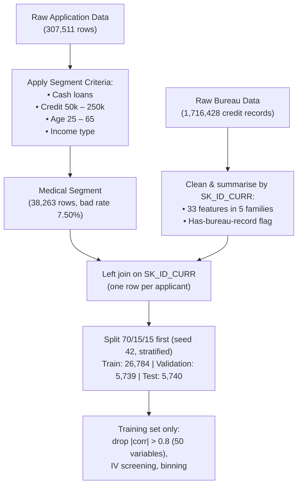

# IS453 Financial Analytics: Credit Scorecard Development
## Project Write-up: Combined Scorecard Notebook
**Academic Term:** IS453 Financial Analytics  
**Course Group:** Section 1, Group 7 (G1 - Group 7)  
**Lending Product Assignment:** **Medical Procedure Loans**  
**Code:** `IS453_G7_Scorecard_Combined.ipynb`  
**Version:** v4 (250k segment, automatic bins; see [version labels](#version-labels))

---

## Executive Summary

Group 7 has developed a credit scorecard for a new retail product: **Medical Procedure Loans**, which finance
out-of-pocket elective and semi-urgent medical costs such as dental restoration, fertility treatment, orthopaedic and
corrective surgery. The analysis runs end to end in one notebook and follows the techniques taught in the Week 9–11 labs.

1. **Segment Filtering & Data Integration:** 38,263 representative applications (12.4%) selected from 307,511 records,
   all cash loans of 50,000 to 250,000. The bad rate is 7.50%, **lower** than the 8.07% for all applications. The segment
   is merged with 1,716,428 bureau credit records, cleaned and summarised into 33 features per applicant.
2. **Train / validation / test split (70/15/15):** 26,784 / 5,739 / 5,740 applicants. Screening, binning and model
   fitting use the training set. Variable selection, the model comparison, the cutoff and the pricing checks use the
   validation set. The test set is used to report the final results.
3. **Screening & Grouping:** 102 candidate variables (after removing 50 highly correlated ones) are screened by
   Information Value: **102 → 49 (fine-classing IV ≥ 0.02) → 41 (after coarse classing) → 32 (after WOE redundancy
   screening) → 14 predictors** chosen by forward selection on validation Gini. The final bins are the automatic
   `sc.woebin` bins.
4. **Logistic Regression & Discrimination:** on the test set, **AUC 0.7080, Gini 0.4159 and K-S 32.12%**, against
   training (AUC 0.7251) and validation (AUC 0.7194).
5. **Scaling (Week 11 lab):** **600 points at odds of 19:1 (5% probability of default), PDO = 20**.
6. **Cutoff, Pricing & Profitability:** the profit-maximising cutoff chosen on validation is **565 points**. On the test
   set it approves **89.2%** of applicants and lowers the bad rate among approved applicants from **7.51% to 6.17%**.
   With a single 15% product rate, a 5% cost of funds, 70% loss given default and an assumed **24-month term for every
   loan**, test profit is **52.8m, against 48.5m if everyone were approved**, a gain of about 9%. These are scenario
   figures, not a forecast.
7. **Pricing:** one product rate of 15% for every approved applicant. Every approved score band breaks even below 15%,
   while the declined band would need about 20.4%. Score bands set the origination checks, not the rate. Charging each
   band its own indicative rate would cut test profit to 29.2m, so tiered rates are not recommended.

> [!NOTE]
> This version (v4) replaces the group's first version (v1, `credit_scorecard_medical.py`), the first notebook (v2) and
> the 500k validation update (v3). The changes, and the reason for each, are in
> [Changes from the First Version](#changes-from-the-first-version),
> [Changes from v2 to v3](#changes-from-v2-to-v3) and [Changes from v3 to v4](#changes-from-v3-to-v4).

### Version labels
| Label | What it is | Commit | Where it is |
| :--- | :--- | :---: | :--- |
| **v1** | script `credit_scorecard_medical.py` and its Dossier | `c4582a1` | `archive/v1-script/` |
| **v2** | first notebook and write-up, before the validation split | `a4295cb` | `archive/v2-before-validation-split/` |
| **v3** | 50k-500k segment with adjusted bins | `2ec24a8` to `4f1d6a4` | `archive/v3-500k-adjusted-bins/` |
| **v4** | 50k-250k segment with automatic bins (current version) | `c995c86` and later | repository root |

---

## Component 1: Business Opportunity, Customer Segment & Product Context

### 1. The Market Opportunity
Insurance often leaves patients paying part of their medical bills themselves through co-payments, deductibles, claim
limits, or elective procedures that are not covered at all, such as:
- **Dental restoration and implants**
- **IVF and fertility treatment**
- **Elective orthopaedic and joint surgery**
- **Corrective and aesthetic surgery**

These costs arrive as a single, known bill that many patients cannot pay from savings. A fixed-instalment loan is cheaper
than revolving credit cards and predictable to repay. For the bank, demand is relatively steady because medical needs do
not follow the economic cycle closely, the purpose is specific (the amount matches a treatment quote), and partnering with
clinics gives a low-cost channel. Decisions are needed quickly at the clinic, which is where an automated scorecard adds
value.

### 2. How the Segment Uses the Product
- A **one-off cash loan** of **50,000 to 250,000** (dataset units) sized to the treatment cost, repaid in **fixed monthly
  instalments**.
- **Smaller amounts**: median loan of 177,903, against 540,000 for all cash loans.
- **Larger instalments relative to the loan**: the median loan ÷ instalment ratio (`AMT_CREDIT / AMT_ANNUITY`) is 12.6
  in the segment, against 20.7 for all cash loans. This is a ratio taken from the data, **not the contract term**, which
  the data does not contain.
- Lower incomes: median annual income of 112,500, against 153,000 for all cash loans.
- Applied for close to the procedure date, often at the clinic.

### 3. Core Business Assumptions
1. **Unsecured instalment loan**, disbursed to the borrower or directly to the healthcare provider.
2. **Proxy segment:** the data has no loan-purpose field, so past cash-loan borrowers who match the filters are assumed to
   behave like future medical-procedure borrowers. The 50,000 to 250,000 range is a modelling assumption, not a proven
   price range for medical bills.
3. **Loss Given Default (LGD) of 70%:** unsecured lending with about 30% recovered.
4. **Product interest rate of 15% APR and cost of funds of 5%** (illustrative, used for the profitability analysis).
5. **Loan term of 24 months for every loan.** The data has no contract term, so the profit analysis assumes 24 months.
   This is a scenario choice, and [Component 6](#6-sensitivity-to-term-and-loss-given-default) shows how the cutoff and
   profit change at 12 and 36 months.
6. **TARGET = 1 (payment difficulties) is treated as a default**, which makes the profit estimates conservative.

---

## Component 2: Data Selection, Preparation & Bureau Merging

### 1. Data Selection Criteria (Week 10 Checkpoint)
- `NAME_CONTRACT_TYPE == 'Cash loans'` (instalment loans, excluding revolving credit).
- `50,000 <= AMT_CREDIT <= 250,000` (a smaller-ticket cash-loan range; excludes very small purchases and the larger loans).
- `25 <= AGE <= 65` (independent adults with elective or restorative medical needs).
- `NAME_INCOME_TYPE` $\in$ `['Working', 'Commercial associate', 'State servant', 'Pensioner']` (a regular income to repay from).
- Loan annuity known and total income above 0.

`ORGANIZATION_TYPE == 'Medicine'` is not used, because it describes the applicant's employer, not the loan's purpose.

### 2. Checkpoint Comparison Metrics
| Metric | Original Application Dataset | Medical Procedure Loan Segment | Variance / Rationale |
| :--- | :---: | :---: | :--- |
| **Total Rows** | 307,511 | **38,263** | Retains **12.4%** of the data; a smaller but still usable sample. |
| **Good Borrowers (0)** | 282,686 (91.93%) | **35,392 (92.50%)** | Most borrowers repay. |
| **Defaulted Borrowers (1)** | 24,825 (8.07%) | **2,871 (7.50%)** | **-0.57 points** in bad rate: the segment is **lower** risk than the full dataset. |

| Filter step | Rows | Bad rate |
| :--- | :---: | :---: |
| Original data | 307,511 | 8.07% |
| 1. Cash loans | 278,232 | 8.35% |
| 2. + loan amount 50k–250k | 44,460 | 7.25% |
| 3. + age 25–65 | 38,266 | 7.50% |
| 4. + income type | 38,265 | 7.50% |
| 5. + annuity known, income > 0 | **38,263** | **7.50%** |

> [!NOTE]
> The lower bad rate comes mainly from the loan-amount filter. Among cash loans, 50k–250k loans have a 7.25% bad rate,
> while 250k–500k and 500k–750k loans have 9.93% and 9.70%. Within the segment, bad rates fall steadily with age, from
> 10.09% for 25–29 year-olds to 4.52% for 55–65 year-olds. Dropping the age rule would give 44,457 applicants and a 7.25%
> bad rate, so the age range is a product assumption and not a demonstrated risk reduction.

### 3. Credit Bureau Cleaning & Aggregation
Because the bureau data has one row per credit (a median of 4 and up to 116 per applicant), joining it directly would
repeat applicants and create false extra "bad" rows. Each applicant's credits are therefore summarised into one row
(Option 3 from the data-merging module) and left-joined on `SK_ID_CURR`.

**Cleaning before summarising:**
- 17 records updated **after** the application date dropped (information the bank would not have had).
- 8,418 negative debts and 351 negative limits set to 0.
- Credits in other currencies are flagged (76 for the segment); no exchange rates are provided.

**33 features in five families** (177,874 bureau rows for the segment, covering 32,157 applicants):
| Family | Examples |
| :--- | :--- |
| Account counts | total, active, closed, sold or bad-debt credits |
| Delinquency | overdue now, ever overdue, largest amount overdue, prolonged credits |
| Exposure | total and active credit and debt, utilisation, debt-to-credit |
| Credit mix | consumer, card, microloan and secured credits; number of credit types |
| History & recency | history length, months since latest credit, credits opened in the last 12 / 24 months |

**Applicants without bureau history:** counts and totals are set to 0, and ratios are left blank so that they get their
own "Missing" bin. A `HAS_BUREAU` flag is added. These applicants are riskier:

| | Applicants | Share | Bad rate |
| :--- | :---: | :---: | :---: |
| No bureau record | 6,106 | 16.0% | **9.96%** |
| Has bureau record | 32,157 | 84.0% | 7.04% |

### 4. Modelling Table & Train/Validation/Test Split
- **Derived variables:** day counts converted to years; ratios such as the loan ÷ instalment ratio
  (`TERM_MONTHS` = `AMT_CREDIT / AMT_ANNUITY`, **not the contract term**), credit-to-goods, credit-to-income and
  debt-to-income; `DAYS_EMPLOYED = 365243` (pensioners and unemployed) set to missing and flagged.
- **`ORGANIZATION_TYPE`** grouped into 35 sectors.
- **Excluded:** `CODE_GENDER` (protected attribute), two raw bureau day-count fields (replaced by year-based versions)
  and 7 columns with a single value.
- **Train/validation/test split, done before any screening.** The notebook uses `train_test_split` with `random_state=42`
  and stratifies on `TARGET`: 70% training (**26,784**), 15% validation (**5,739**) and 15% test (**5,740**), with bad
  rates of 7.50%, 7.49% and 7.51%. This extends the Week 11 lab's 70/30 split.
- **Why split first (no data leakage):**
  - **Training set:** correlation screening, IV, fine and coarse binning, WOE and the logistic regression coefficients
    all learn from the training set only. The validation and test sets are only scored with the bins and coefficients it
    produced.
  - **Validation set:** used to choose variables during forward selection, compare model options, choose the cutoff and
    estimate the pricing bands.
  - **Test set:** used to report the final results. The notebook's final selection does not depend on it, but see the
    [Limitations](#limitations--risks) for how earlier experiments used it.
- **Highly correlated variables (Week 9 lab):** 119 pairs with |correlation| > 0.8 in the training set; the variable less
  correlated with TARGET is dropped in each pair (50 variables), mostly duplicate building statistics. 102 predictors
  remain.

---

## Component 3: Screening & Grouping of Variables (WoE & IV)

### 1. Screening by Information Value (Week 10 lab)
Each of the 102 candidate variables was fine-classed on the training set into 20 equal-frequency bins (`pd.qcut`),
using the course formulas (with 0.5 added to the good and bad counts of each bin to avoid infinite values):
$$\text{WoE}_j = \ln\left( \frac{\% \text{Goods}_j}{\% \text{Bads}_j} \right) \quad \text{and} \quad \text{IV} = \sum_j (\% \text{Goods}_j - \% \text{Bads}_j) \times \text{WoE}_j$$

| IV range | Predictive power | Variables |
| :--- | :--- | :---: |
| < 0.02 | Unpredictive (dropped) | 53 |
| 0.02 – 0.10 | Weak | 41 |
| 0.10 – 0.30 | Medium | 8 |

**49 variables pass.** The strongest are the loan ÷ instalment ratio (0.297), external score `EXT_SOURCE_1` (0.177), share
of bureau credits active (0.151), years employed (0.137), bureau debt-to-credit (0.137), years of bureau history (0.129),
months since the latest bureau credit (0.109) and age (0.107). The full list is in `g7_iv_fine_classing.csv`.

### 2. Coarse Classing (Week 10 & Week 11 labs)
`sc.woebin` groups each variable into coarse bins on the training set, with at least 5% of applicants in each bin and a
separate missing bin. **The automatic bins are the final bins.** After coarse classing, **41 variables keep IV ≥ 0.02**.

The notebook's monotonic check flags **13** numeric variables whose automatic bins do not show a one-direction trend.
Five of them are among the 14 final predictors: `TERM_MONTHS`, `CREDIT_TO_GOODS`, `AMT_CREDIT`, `BUR_N_OPENED_12M` and
`LIVINGAREA_MEDI`. The other eight are not in the final model.

A set of **manually adjusted bins** (`breaks_list`, Week 10 Ex Q3) is kept **for comparison only**. It is not used by the
final scorecard, and it is not fully monotonic either. For the characteristics where it changes the bins, the adjusted
edges and the IV they give, against the automatic bins, are:

| Characteristic | Adjusted bin edges (comparison only) | IV, adjusted bins | IV, automatic bins |
| :--- | :--- | :---: | :---: |
| `TERM_MONTHS` (loan ÷ instalment ratio) | 10.5, 21.5 | 0.113 | **0.227** |
| `CREDIT_TO_GOODS` | 1.14, 1.25 | 0.050 | 0.072 |
| `AMT_CREDIT` | 110k, 180k | 0.033 | 0.045 |
| `AMT_ANNUITY` | 13k, 16k | 0.004 | 0.034 |
| `REGION_POPULATION_RELATIVE` | 0.021, 0.032 | 0.017 | 0.018 |

> [!IMPORTANT]
> **`TERM_MONTHS` stays non-monotonic on purpose.** It is the strongest variable, and it is a loan ÷ instalment ratio
> (loan amount divided by the monthly instalment), **not the contract term**. Its automatic bins give bad rates of 9.90%
> below 9.0, 5.49% from 9.0 to 9.5, **2.43% from 9.5 to 10.5**, **12.06% from 10.5 to 13.0** and 8.07% at 13.0 or above.
> Three checks support keeping this shape:
> - **The pattern repeats on validation:** 2.30% for 9.5 to 10.5 and 12.96% for 10.5 to 13.0.
> - **It holds within every loan-size band**, in training and in validation (table below).
> - **The step is sharp:** in training the bad rate is 4.61% for ratios of 10.5 to 10.75 and 14.81% for 10.75 to 11.0.
>
> Collapsing them into the three adjusted bins would halve the variable's IV (0.227 to 0.113). The pattern is an observed
> association, not a causal effect, and the 9.5 to 10.5 group is older (median age 49.4 against 37.4 in training), so
> the variable should be monitored after launch.

| Loan amount band | 9.5–10.5, training | 10.5–13.0, training | 9.5–10.5, validation | 10.5–13.0, validation |
| :--- | :---: | :---: | :---: | :---: |
| 50,000 – 99,999 | 1.63% | 10.87% | 1.23% | 8.97% |
| 100,000 – 149,999 | 2.64% | 9.27% | 2.02% | 9.22% |
| 150,000 – 199,999 | 2.64% | 12.85% | 1.67% | 9.92% |
| 200,000 – 250,000 | 2.67% | 13.42% | 3.94% | 17.63% |

> [!NOTE]
> `scorecardpy` defines WoE as ln(% Bads / % Goods), the opposite sign to the Week 10 formula, so a *positive* WoE
> marks a *riskier* bin and the model's coefficients are positive. The IV is identical.

---

## Component 4: Logistic Regression & Model Performance

### 1. Variable Selection
1. The 41 WoE variables are reduced to **32 candidates**: where two WoE variables have |correlation| > 0.8, the one with
   the higher IV is kept.
2. **Forward selection on validation Gini:** at each step, the variable that raises the **validation** Gini the most is
   added, as long as every coefficient stays above 0.1 (correct sign and a meaningful weight). Selection stops when no
   remaining variable adds at least 0.002, which happened at **14 variables**.

| Step | Variable added | Training Gini | Validation Gini |
| :---: | :--- | :---: | :---: |
| 1 | `TERM_MONTHS` | 0.2318 | 0.2327 |
| 2 | `YEARS_EMPLOYED` | 0.3014 | 0.3096 |
| 3 | `BUR_SHARE_ACTIVE` | 0.3530 | 0.3460 |
| 4 | `EXT_SOURCE_1` | 0.3896 | 0.3722 |
| 5 | `NAME_EDUCATION_TYPE` | 0.4010 | 0.3883 |
| 6 | `BUR_N_OPENED_12M` | 0.4082 | 0.3982 |
| 7 | `BUR_MAX_AMT_OVERDUE` | 0.4170 | 0.4064 |
| 8 | `YEARS_ID_PUBLISH` | 0.4227 | 0.4134 |
| 9 | `OCCUPATION_TYPE` | 0.4268 | 0.4195 |
| 10 | `CREDIT_TO_GOODS` | 0.4329 | 0.4246 |
| 11 | `LIVINGAREA_MEDI` | 0.4363 | 0.4289 |
| 12 | `BUR_UTILISATION` | 0.4421 | 0.4338 |
| 13 | `AMT_CREDIT` | 0.4461 | 0.4362 |
| 14 | `NAME_FAMILY_STATUS` | 0.4500 | 0.4383 |

### 2. Model Parameters
`LogisticRegression` on the WoE values (Week 11 lab), trained on 26,784 applicants (training set only):

| Characteristic ($X_i$) | Coefficient ($\beta_i$) | IV (coarse) |
| :--- | :---: | :---: |
| **Intercept ($\beta_0$)** | **-2.5152** | n/a |
| `TERM_MONTHS_woe` | 0.6530 | 0.227 |
| `YEARS_EMPLOYED_woe` | 0.4907 | 0.132 |
| `BUR_SHARE_ACTIVE_woe` | 0.7460 | 0.148 |
| `EXT_SOURCE_1_woe` | 0.6602 | 0.164 |
| `NAME_EDUCATION_TYPE_woe` | 0.8101 | 0.031 |
| `BUR_N_OPENED_12M_woe` | 1.0295 | 0.028 |
| `BUR_MAX_AMT_OVERDUE_woe` | 0.8547 | 0.044 |
| `YEARS_ID_PUBLISH_woe` | 0.4952 | 0.052 |
| `OCCUPATION_TYPE_woe` | 0.3912 | 0.077 |
| `CREDIT_TO_GOODS_woe` | 0.4813 | 0.072 |
| `LIVINGAREA_MEDI_woe` | 0.7685 | 0.021 |
| `BUR_UTILISATION_woe` | 0.6990 | 0.041 |
| `AMT_CREDIT_woe` | 0.6137 | 0.045 |
| `NAME_FAMILY_STATUS_woe` | 0.5674 | 0.041 |

> [!IMPORTANT]
> **Key Diagnostic Highlights for Presentation:**
> - **Sign Consistency:** all coefficients are positive, which with `scorecardpy`'s WoE means riskier bins correctly
>   raise the log-odds of default.
> - **Balanced inputs:** 7 application characteristics, 3 loan characteristics (the loan ÷ instalment ratio,
>   credit-to-goods and the loan amount) and 4 bureau characteristics.

### 3. Discrimination & Model Performance (Train vs Validation vs Test)
| Evaluation Metric | Training Set (70%) | Validation Set (15%) | Test Set (15%) | Interpretation |
| :--- | :---: | :---: | :---: | :--- |
| **ROC - AUC** | 0.7251 | 0.7194 | **0.7080** | Solid discrimination for application data. |
| **Gini** | 0.4503 | 0.4387 | **0.4159** | Test is a little lower, as expected after validation-based selection; no sign of severe overfitting. |
| **Kolmogorov-Smirnov (K-S)** | 33.81% | 35.06% | **32.12%** | On the test set, the widest separation of goods and bads is at score **581**. |

| Calibration | Observed bad rate | Mean predicted probability | Brier score |
| :--- | :---: | :---: | :---: |
| Training | 7.50% | 7.51% | 0.0659 |
| Validation | 7.49% | 7.59% | 0.0661 |
| Test | 7.51% | 7.57% | 0.0667 |

The average predicted probability of default is within 0.10 percentage points of the observed bad rate on every set. On
the validation set, the expected defaults from the scores match the actual ones at the chosen cutoff (304 expected
against 304 actual at 565, see [Component 6](#3-cutoff-optimisation--profitability-analysis)).

**Reading the ROC curve (left).** The scorecard is used to catch defaulters, so the chart starts from the lowest scores
and works upwards. The y-axis is the share of all defaulters caught so far, and the x-axis is the share of good payers
caught along with them. A useless score would follow the dashed diagonal (catching defaulters no faster than good
payers). The curves bow clearly above it. The **AUC (area under the curve)** sums this up: 0.5 is random, 1.0 is perfect,
and 0.708 on the test set is solid for application data.

**Reading the K-S chart (right).** For every score, one line is the share of all defaulters scoring at or below it, and
the other is the share of all good payers. Defaulters pile up at low scores, so their line rises first. The
**K-S statistic is the widest vertical gap between the lines: 32.12% on the test set, at score 581**. It is the point of
strongest separation, and it lies 16 points above the chosen cutoff of 565.

*Score distribution of all 38,263 applicants (training, validation and test combined, Week 11 lab). Scores run from 514
to 706.*

---

## Component 5: Model Tuning

Options are compared on the **validation** set (5,739 applicants, bad rate 7.49%). The test set is not used to choose
between them; it is scored once, after the model is locked.

| Option | Variables | Training Gini | Validation Gini | Wrong-sign coefficients | Average predicted PD (validation) |
| :--- | :---: | :---: | :---: | :---: | :---: |
| **Selected variables, automatic `sc.woebin` bins (chosen)** | 14 | 0.4500 | **0.4383** | 0 | 7.59% |
| Selected variables, adjusted monotonic bins | 14 | 0.4332 | 0.4245 | 0 | 7.55% |
| First 5 selected variables | 5 | 0.4010 | 0.3883 | 0 | 7.54% |
| First 10 selected variables | 10 | 0.4329 | 0.4246 | 0 | 7.56% |
| All 32 candidate variables | 32 | 0.4745 | 0.4311 | 5 | 7.59% |
| Selected + `class_weight='balanced'` (Week 9 lab) | 14 | 0.4499 | 0.4382 | 0 | 43.72% |

*Actual validation bad rate: 7.49%. Source: `g7_tuning_validation.csv`.*

**Automatic vs adjusted bins, same 14 predictors (validation):**

| Binning | AUC | Gini | K-S | Brier score | Total bins | Bins under 5% |
| :--- | :---: | :---: | :---: | :---: | :---: | :---: |
| **Automatic (chosen)** | **0.7194** | **0.4387** | **35.06%** | 0.0661 | 62 | 0 |
| Adjusted (monotonic `breaks_list`) | 0.7127 | 0.4253 | 33.01% | 0.0664 | 57 | 0 |

*Source: `g7_binning_comparison_validation.csv`.*

The difference comes almost entirely from **`TERM_MONTHS`** (loan ÷ instalment ratio), whose IV doubles from 0.113 (three
adjusted bins) to 0.227 (five automatic bins). Its automatic bins are not monotonic, but the pattern is stable between
training and validation:

| TERM_MONTHS bin | Training applicants | Training bad rate | Validation bad rate |
| :--- | :---: | :---: | :---: |
| below 9.0 | 1,899 | 9.90% | 8.54% |
| 9.0–9.5 | 3,931 | 5.49% | 6.53% |
| 9.5–10.5 | 4,566 | 2.43% | 2.30% |
| 10.5–13.0 | 4,312 | 12.06% | 12.96% |
| 13.0 and above | 12,076 | 8.07% | 7.68% |

> [!TIP]
> **Tuning Decisions:**
> - **Automatic bins are used in the final model.** They raise validation AUC from 0.7127 to 0.7194 and K-S from 33.0% to
>   35.1% with the same 14 variables, no wrong-sign coefficients and good calibration (7.59% predicted vs 7.49% observed).
> - **Non-monotonic `TERM_MONTHS` bins are kept on purpose.** Forcing a monotonic trend would merge bins with very
>   different risk (2.43% vs 12.06%) and hide risk the data shows. Each bin holds at least 7% of training applicants and
>   the pattern repeats on validation. It is an observed association, not a causal effect (the variable is a loan ÷
>   instalment ratio, not the contract term), so it is flagged for monitoring after launch.
> - **14 variables:** each extra variable adds less; steps 13 and 14 add about 0.002 validation Gini each, and gains
>   flatten after about 10 variables.
> - **All 32 candidate variables** reach the highest training Gini (0.4745) but a lower validation Gini (0.4311) and five
>   wrong-sign coefficients: overfitting, and their points would contradict their own bins.
> - **`class_weight='balanced'`** leaves the ranking unchanged (0.4382) but inflates the average predicted PD to 43.72%
>   (actual 7.49%), which breaks the 600 = 5% PD scaling and the expected-default calculation.

**Impact on the rest of the pipeline:** the locked model scores test AUC 0.7080, Gini 0.4159 and K-S 32.12%, and the
validation profit-maximising cutoff becomes **565** (see Component 6).

---

## Component 6: Scorecard Scaling, Cutoff Selection & Profitability

### 1. Scaling Mathematics (Week 11 lab)
- $\text{Target Score} = 600$ at $\text{odds (bad:good)} = 1:19$, i.e. a 5% probability of default; $\text{PDO} = 20$.
- $\text{Factor} = \frac{\text{PDO}}{\ln(2)} = \frac{20}{0.69315} = \mathbf{28.8539}$.
- $\text{Offset} = 600 + \text{Factor} \times \ln(1/19) = 600 - 28.8539 \times 2.94444 = \mathbf{515.0414}$.
- Built with `sc.scorecard(bins, lr, ..., points0=600, odds0=1/19, pdo=20, basepoints_eq0=True)`, which spreads the
  base points across the 14 characteristics. Scores range from 514 to 706.

### 2. Complete Scorecard Points Table
Share of applicants and bad rate are from the training set. The full table is saved as `g7_final_bins_and_points.csv`.

| Characteristic | Attribute | Share of applicants | Bad rate | Points |
| :--- | :--- | :---: | :---: | :---: |
| **Loan ÷ instalment ratio (`TERM_MONTHS`)** | < 9 | 7.1% | 9.9% | **36** |
|  | 9 – 9.5 | 14.7% | 5.5% | **48** |
|  | 9.5 – 10.5 | 17.0% | 2.4% | **64** |
|  | 10.5 – 13 | 16.1% | 12.1% | **32** |
|  | ≥ 13 | 45.1% | 8.1% | **40** |
| **Years employed (`YEARS_EMPLOYED`)** | Missing (pensioner / not employed) | 20.0% | 4.7% | **49** |
|  | < 3.5 | 33.5% | 10.3% | **37** |
|  | 3.5 – 5.5 | 13.8% | 8.9% | **39** |
|  | 5.5 – 14 | 24.6% | 6.6% | **44** |
|  | ≥ 14 | 8.1% | 3.6% | **53** |
| **Share of bureau credits active (`BUR_SHARE_ACTIVE`)** | Missing (no bureau record) | 16.1% | 10.5% | **34** |
|  | < 0.24 | 27.4% | 4.4% | **54** |
|  | 0.24 – 0.4 | 18.1% | 5.5% | **49** |
|  | 0.4 – 0.52 | 17.1% | 7.9% | **41** |
|  | ≥ 0.52 | 21.3% | 10.6% | **34** |
| **External score (`EXT_SOURCE_1`)** | Missing | 58.2% | 7.8% | **41** |
|  | < 0.26 | 7.6% | 14.8% | **27** |
|  | 0.26 – 0.4 | 8.7% | 8.7% | **39** |
|  | 0.4 – 0.58 | 11.4% | 5.5% | **48** |
|  | 0.58 – 0.7 | 6.5% | 4.4% | **53** |
|  | ≥ 0.7 | 7.5% | 2.2% | **66** |
| **Education (`NAME_EDUCATION_TYPE`)** | Academic degree, Higher education | 19.0% | 5.1% | **51** |
|  | Secondary / secondary special, Incomplete higher, Lower secondary | 81.0% | 8.1% | **40** |
| **Credits opened in last 12 months (`BUR_N_OPENED_12M`)** | 0 | 51.3% | 7.0% | **44** |
|  | 1 | 25.7% | 6.8% | **45** |
|  | 2 | 12.9% | 8.0% | **40** |
|  | 3 or more | 10.1% | 11.1% | **29** |
| **Largest amount ever overdue (`BUR_MAX_AMT_OVERDUE`)** | Missing (never recorded) | 41.4% | 8.2% | **40** |
|  | < 500 | 38.1% | 5.8% | **49** |
|  | 500 – 14,000 | 15.1% | 9.0% | **37** |
|  | ≥ 14,000 | 5.4% | 10.1% | **34** |
| **Years since ID document issued (`YEARS_ID_PUBLISH`)** | < 2 | 8.2% | 10.3% | **37** |
|  | 2 – 7 | 25.9% | 8.9% | **39** |
|  | 7 – 11.5 | 36.1% | 7.6% | **42** |
|  | ≥ 11.5 | 29.7% | 5.4% | **47** |
| **Occupation (`OCCUPATION_TYPE`)** | Missing | 33.0% | 5.9% | **45** |
|  | IT staff, HR staff, Accountants, High skill tech staff | 5.8% | 4.5% | **48** |
|  | Realty agents, Medicine staff, Managers, Core staff, Secretaries, Cleaning staff, Private service staff | 18.4% | 6.3% | **44** |
|  | Waiters/barmen staff, Sales staff, Security staff, Cooking staff, Laborers, Drivers, Low-skill Laborers | 42.8% | 9.7% | **39** |
| **Credit-to-goods ratio (`CREDIT_TO_GOODS`)** | < 1.01 | 35.1% | 7.4% | **42** |
|  | 1.01 – 1.1 | 16.1% | 6.4% | **44** |
|  | 1.1 – 1.17 | 23.3% | 5.4% | **47** |
|  | 1.17 – 1.24 | 10.4% | 8.7% | **40** |
|  | ≥ 1.24 | 15.2% | 11.4% | **36** |
| **Living area, normalised (`LIVINGAREA_MEDI`)** | Missing | 53.9% | 8.1% | **40** |
|  | < 0.02 | 7.0% | 8.8% | **38** |
|  | 0.02 – 0.05 | 6.9% | 7.5% | **42** |
|  | 0.05 – 0.09 | 15.6% | 5.9% | **48** |
|  | ≥ 0.09 | 16.6% | 6.3% | **46** |
| **Bureau utilisation (`BUR_UTILISATION`)** | Missing (no bureau record or no active credit) | 33.8% | 7.6% | **42** |
|  | < 0.35 | 20.8% | 5.7% | **48** |
|  | 0.35 – 0.7 | 19.2% | 6.6% | **45** |
|  | 0.7 – 0.85 | 11.4% | 8.2% | **40** |
|  | ≥ 0.85 | 14.8% | 10.3% | **35** |
| **Loan amount (`AMT_CREDIT`)** | < 80,000 | 6.6% | 4.4% | **52** |
|  | 80,000 – 155,000 | 32.9% | 6.2% | **46** |
|  | 155,000 – 165,000 | 5.3% | 10.1% | **36** |
|  | ≥ 165,000 | 55.1% | 8.4% | **40** |
| **Family status (`NAME_FAMILY_STATUS`)** | Widow | 6.1% | 4.7% | **50** |
|  | Married | 58.4% | 6.8% | **44** |
|  | Separated | 7.9% | 7.3% | **42** |
|  | Single / not married, Civil marriage | 27.6% | 9.6% | **38** |

> [!NOTE]
> The loan amount has a narrow bin from 155,000 to 165,000. It holds 5.4% of training applicants and has a 10.1% bad
> rate, so it scores 36 points, below both neighbouring bins (46 and 40). See the [Limitations](#limitations--risks).

### 3. Cutoff Optimisation & Profitability Analysis
*Profit per good loan = interest at 15% APR minus 5% cost of funds, over an assumed 24-month term, on the applicant's
own loan amount. Loss per bad loan = 70% of the loan amount. The cutoff is chosen on the validation set and reported on
the test set.*

**Expected and actual defaults on the validation set** (5,739 applicants). Expected defaults use odds (good:bad) =
19 × 2^((score − 600)/20), as in the Week 11 lab:

| Cutoff Score | Approval Rate (%) | Expected Defaults | Actual Defaults | Bad Rate in Approved (%) |
| :---: | :---: | :---: | :---: | :---: |
| 550 | 97.8% | 398 | 397 | 7.07% |
| 560 | 92.8% | 340 | 347 | 6.52% |
| **565 (Chosen)** | **88.9%** | **304** | **304** | **5.96%** |
| 570 | 83.7% | 262 | 263 | 5.48% |
| 580 | 72.3% | 189 | 184 | 4.43% |
| 590 | 58.0% | 120 | 121 | 3.64% |
| 600 | 43.0% | 68 | 73 | 2.96% |

**Profit at every cutoff** (test set, 5,740 applicants; amounts in millions of the data's currency; 15% APR, 24-month term):

| Cutoff Score | Approval Rate (%) | Approved Loans | Defaulted Loans | Bad Rate in Approved (%) | Net Interest from Good Loans | Default Losses | **Net Profit** |
| :---: | :---: | :---: | :---: | :---: | :---: | :---: | :---: |
| Approve all | 100.0% | 5,740 | 431 | 7.51% | 101.4 | 53.0 | **48.5** |
| 540 | 99.4% | 5,705 | 420 | 7.36% | 100.9 | 51.4 | **49.5** |
| 550 | 97.9% | 5,618 | 403 | 7.17% | 99.5 | 49.3 | **50.1** |
| 560 | 93.0% | 5,340 | 348 | 6.52% | 94.8 | 41.8 | **53.0** |
| **565 (Chosen)** | **89.2%** | **5,118** | **316** | **6.17%** | **90.7** | **37.9** | **52.8** |
| 570 | 84.4% | 4,847 | 278 | 5.74% | 86.0 | 32.9 | **53.1** |
| 580 | 72.9% | 4,183 | 194 | 4.64% | 74.2 | 22.2 | **52.0** |
| 590 | 58.3% | 3,348 | 125 | 3.73% | 58.7 | 13.9 | **44.8** |
| 600 | 43.7% | 2,507 | 77 | 3.07% | 43.3 | 8.1 | **35.2** |
| 610 | 30.7% | 1,762 | 47 | 2.67% | 29.9 | 4.8 | **25.1** |
| 620 | 20.1% | 1,152 | 24 | 2.08% | 19.2 | 2.2 | **17.1** |
| 630 | 12.1% | 692 | 13 | 1.88% | 11.3 | 1.1 | **10.3** |
| 640 | 6.7% | 382 | 5 | 1.31% | 6.2 | 0.4 | **5.8** |
| 650 | 3.3% | 191 | 1 | 0.52% | 3.0 | 0.0 | **2.9** |

*Profit by cutoff for the training, validation and test sets, each scaled up to the full applicant base. The dashed line
marks the validation-chosen cutoff of 565. The test curve is for final evaluation only.*

**How to read it.** "Net interest from good loans" is the interest earned on approved loans that are repaid, after the
bank's own funding cost. "Default losses" are 70% of each approved loan that defaults. Raising the cutoff removes bad
loans faster than good ones at first, so losses fall more than interest and profit rises. Past about 570, the scorecard
starts turning away mostly good payers, so interest falls faster than losses and profit drops. The curve is flat between
560 and 580 (52.0m to 53.1m), so small differences between these cutoffs should not be over-read. 565 is the maximum on
validation, which is why it is the one reported.

> [!TIP]
> **Executive Trade-off:** a cutoff of 565 raises test profit from 48.5m to 52.8m (about 9% higher) and lowers the bad
> rate among approved applicants from 7.51% to 6.17%, at the cost of declining about 11% of applicants. The gain over
> approving everyone is much smaller than in v3 (about 33%) because the segment is lower risk and the loans are smaller.
> If the bank prioritises quality, a cutoff of 580 gives 52.0m with a 4.64% bad rate and approves 72.9%.

### 4. Confusion Matrix at Recommended Cutoff (565)
*Evaluation on 5,740 test applicants (Positive = Good Repayer, Negative = Defaulter), as in the Week 11 lab:*

| | **Predicted Good (Score $\ge 565$)** | **Predicted Defaulter (Score $< 565$)** | Total |
| :--- | :---: | :---: | :---: |
| **Actual Good (0)** | **4,802 (TP)** | 507 (FN) | 5,309 |
| **Actual Defaulter (1)** | 316 (FP) | **115 (TN)** | 431 |
| **Total** | 5,118 | 622 | 5,740 |

| Measure | Value | Meaning |
| :--- | :---: | :--- |
| **Accuracy** | **85.66%** | share of applicants classified correctly |
| **Error Rate** | **14.34%** | share classified wrongly (1 − accuracy) |
| **Sensitivity / Recall (goods)** | **90.45%** | share of good payers who are approved |
| **Specificity (defaulters)** | **26.68%** | share of defaulters declined before receiving a loan |
| **Precision** | **93.83%** | share of approved applicants who repay |
| **F-1 Score (goods)** | **92.11%** | balance of precision and recall: 2 × P × R / (P + R) |

> [!NOTE]
> Accuracy (86%) is lower than simply approving everyone would give (92%, since 92% of applicants repay). The cutoff is
> chosen to maximise profit, not accuracy. A missed defaulter costs 70% of the loan, while a declined good payer costs
> only the lost interest. The high F-1 score (0.92) mostly reflects that most applicants are good payers. The scorecard
> declines about one in ten good payers but catches only about one in four defaulters, so it trims risk without removing
> it.

### 5. Interest Rate and Pricing (Recommended Approach)
**Recommendation: charge one product rate of 15% APR to every approved applicant.**

Score bands are used to set the **origination checks**, not the interest rate. The break-even APR is the lowest rate at
which a band's interest covers its default losses and the cost of funds. It is estimated on the **validation** set
(5,739 applicants, 24-month term, 70% LGD):

| Tier | Score range | Applicants (validation) | Bad rate | Break-even APR | Origination checks | Rate charged |
| :--- | :---: | :---: | :---: | :---: | :--- | :---: |
| **Tier 1 (Prime)** | ≥ 625 | 905 | 1.66% | 6.1% | Approve with standard documents; verify clinic before direct payment | 15% |
| **Tier 2 (Near prime)** | 605 – 624 | 1,202 | 3.24% | 7.1% | Approve with standard documents and verified clinic quote | 15% |
| **Tier 3 (Standard)** | 585 – 604 | 1,646 | 5.53% | 8.8% | Approve after income and clinic-plan checks | 15% |
| **Tier 4 (Higher risk)** | 565 – 584 | 1,348 | 11.80% | 13.5% | Approve after full income and verified clinic-plan review | 15% |
| **Decline** | < 565 | 638 | 19.75% | 20.4% | Decline, or refer for a co-signer or security | Declined |

- **Every approved band breaks even below 15%.** The highest approved break-even rate is 13.5% (Tier 4), so the 15%
  product rate covers every approved band's losses and funding cost.
- **The declined band needs about 20.4%** just to break even, well above the 15% product rate, which is why
  applicants below 565 are declined.
- **Origination checks** increase as the score falls. The best bands are approved with standard documents, which suits a
  decision made at the clinic; Tier 4 gets a full income and clinic-plan review because its bad rate (11.80%) is closest
  to the decline band.
- **The tiers change the checks, not the rate.**

**Why not price each tier separately?** An indicative rate for each tier is its break-even APR plus a 3-point margin,
rounded up to the nearest 0.5%: 9.5% for Tier 1, 10.5% for Tier 2, 12.0% for Tier 3 and 16.5% for Tier 4. If each tier
paid its indicative rate instead of 15%, test profit at cutoff 565 would fall to **29.2m**, which is below the **48.5m**
from approving everyone at 15%, and well below the **52.8m** from a single 15% rate at the same cutoff. Tiered rates are
therefore not recommended. The margin is a business decision, and the break-even rates are estimated on the validation
set, so they are a scenario and not a market-ready price list.

### 6. Sensitivity to Term and Loss Given Default
The data has no contract term, so the profit analysis assumes 24 months and a 70% LGD. The table re-runs the cutoff
search on the **validation** set for other terms and loss rates (profit in millions, validation set only, so not
comparable with the test figures above):

| Term (months) | LGD | Best cutoff (validation) | Profit at cutoff 565 (m) | Maximum profit (m) |
| :---: | :---: | :---: | :---: | :---: |
| 12 | 50% | 580 | 18.6 | 21.2 |
| 12 | 70% | 585 | 7.9 | 16.0 |
| 12 | 90% | 595 | -2.7 | 11.2 |
| 24 | 50% | 555 | 63.1 | 63.2 |
| **24** | **70%** | **565** | **52.5** | **52.5** |
| 24 | 90% | 580 | 41.8 | 45.0 |
| 36 | 50% | 540 | 110.3 | 114.9 |
| 36 | 70% | 550 | 99.7 | 100.8 |
| 36 | 90% | 565 | 89.0 | 89.0 |

*Bold row: the base case used throughout (24 months, LGD 70%).*

**What it means for the cutoff.** At the 24-month base case the profit-maximising cutoff is **565**. Across the nine
scenarios the best cutoff ranges from **540** (36 months, LGD 50%) to **595** (12 months, LGD 90%). Shorter terms and
higher loss rates push the cutoff up, because there is less interest to cover each default; longer terms pull it down.
Keeping 565 costs little at 24 and 36 months (at most 4.6m below the best cutoff), but at 12 months profit is thin: with
LGD 70%, 565 earns 7.9m against 16.0m at the best cutoff (585), and with LGD 90% it makes a loss of 2.7m against a best
profit of 11.2m (at 595). The level of profit depends heavily on the term: with LGD 70%, validation profit at 565 is 7.9m
at 12 months, 52.5m at 24 months and 99.7m at 36 months. The 24-month figure should therefore be read as a scenario, and
the term should be confirmed with the product team before the profit numbers are quoted as targets.

---

## Component 7: Scorecard Walkthrough with Example Applicants

Three real test-set applicants at the 10th, 50th and 90th percentile of score, scored with `sc.scorecard_ply` (Week 11
Ex Q1 style). The notebook checks that each point total matches the scoring pipeline. The results are saved in
`g7_applicant_walkthrough_test.csv`.

| Characteristic | Applicant 190847 | Pts | Applicant 388013 | Pts | Applicant 319977 | Pts |
| :--- | :--- | :---: | :--- | :---: | :--- | :---: |
| Loan ÷ instalment ratio | 15.4 | 40 | 18.2 | 40 | 10 | 64 |
| Years employed | 5.7 | 44 | Missing | 49 | 1.22 | 37 |
| Share of bureau credits active | Missing | 34 | Missing | 34 | 0 | 54 |
| External score | Missing | 41 | 0.68 | 53 | 0.406 | 48 |
| Education | Secondary / secondary special | 40 | Secondary / secondary special | 40 | Secondary / secondary special | 40 |
| Credits opened in last 12 months | 0 | 44 | 0 | 44 | 0 | 44 |
| Largest amount ever overdue | Missing | 40 | Missing | 40 | Missing | 40 |
| Years since ID document issued | 5.85 | 39 | 10.9 | 42 | 15.2 | 47 |
| Occupation | Low-skill Laborers | 39 | Missing | 45 | Sales staff | 39 |
| Credit-to-goods ratio | 1 | 42 | 1.2 | 40 | 1 | 42 |
| Living area, normalised | Missing | 40 | 0.0641 | 48 | 0.0546 | 48 |
| Bureau utilisation | Missing | 42 | Missing | 42 | Missing | 42 |
| Loan amount | 225,000 | 40 | 226,422 | 40 | 112,500 | 46 |
| Family status | Single / not married | 38 | Single / not married | 38 | Separated | 42 |
| **Total Score** | **563** | | **595** | | **633** |
| **Decision** | **Decline** | | **Approve (Tier 3 checks)** | | **Approve (Tier 1 checks)** |

- **Applicant 190847 (563, declined by 2 points):** a loan ÷ instalment ratio of 15.4 (40 points), no bureau record
  (34 points on share of active credits) and no external score (41) keep the total just under the cutoff. This applicant
  actually repaid, an example of a good payer turned away by the cutoff.
- **Applicant 388013 (595, approved with Tier 3 checks):** an external score of 0.68 (53 points) and a living-area
  value of 0.064 (48) outweigh no bureau record (34). This applicant repaid.
- **Applicant 319977 (633, approved with Tier 1 checks):** a loan ÷ instalment ratio of 10.0 falls in the safest bin
  (64 points), and no active bureau credits score 54. This applicant repaid.

---

## Changes from the First Version

The segment definition is unchanged except for the loan range (see [Changes from v3 to v4](#changes-from-v3-to-v4)). The
table summarises what changed from the first version (v1, `credit_scorecard_medical.py`) to the current version (v4) and
why.

| # | Area | First version (v1) | This version (v4) | Reason |
| :---: | :--- | :--- | :--- | :--- |
| 1 | Code | Python script | notebook following the Week 9–11 labs | matches the techniques taught; each step can be explained against the labs |
| 2 | Bureau cleaning | not applied | post-application records dropped, negative amounts set to 0, foreign currency flagged | negative debts would make applicants look safer; later records are leakage |
| 3 | Bureau features | 7 summaries | 33 features + `HAS_BUREAU` | adds signals now in the model: share of active credits, recent credits, largest overdue amount, utilisation |
| 4 | No bureau record | debt ratio became 0, placing them in the lowest-debt bin (73 points) | ratio left blank, own Missing bin (for example 34 points on share of active credits, against 54 for the lowest-share bin) | these applicants are riskier (9.96% vs 7.04%) |
| 5 | Screening | IV reported for 8 selected variables | Week 9 correlation rule, then IV for all 102 candidates (49 pass) | the brief asks for screening of the available variables (Week 10 lab) |
| 6 | Binning | fixed bin edges; payment-rate points 68 / 70 / 61 / 79 | automatic `sc.woebin` bins, with adjusted `breaks_list` bins kept for comparison | automatic bins give a higher validation Gini; the one strongly non-monotonic variable is explained |
| 7 | Variable selection | fixed set of 8 | forward selection on validation Gini, 14 variables, coefficient rule | adds predictive variables while keeping every coefficient meaningful |
| 8 | Model fitting | statsmodels coefficients reported, sklearn coefficients used for points | one sklearn `LogisticRegression` | reported and applied coefficients are the same |
| 9 | Scaling | 600 = 50:1 | 600 = 19:1 (5% PD) | matches the Week 11 lab (`odds0 = 1/19`); scores are not comparable between versions |
| 10 | Split | `train_test_split` (train/test) | 70/15/15 train/validation/test, done before screening | no leakage: choices use training and validation data, test is for reporting |
| 11 | Performance | AUC 0.684, K-S 26.9% | test AUC 0.7080, Gini 0.4159, K-S 32.12%, calibration and PCC measures | better discrimination and calibration checks taught in Week 11 |
| 12 | Tuning | none | 6 options compared on validation, plus an automatic vs adjusted bin comparison | the brief asks for the tuning approach and results |
| 13 | Profit | average loan of 250,000, 18% margin, 10,000-applicant cohort | each loan's own amount, fixed 24-month term, 15% APR less 5% funding, 70% LGD | links profit to an interest rate and to each applicant's loan |
| 14 | Pricing | 3 tiers at 6.5% / 8.5% / 12% | one 15% product rate; score bands set the origination checks | tiered rates would cut test profit to 29.2m, below approving everyone (48.5m) |
| 15 | Examples | 3 illustrative profiles | 3 real test applicants | shows the scorecard on actual data values |
| 16 | Consistency | some dossier tables differed from the script's outputs | every number from one notebook run, with audit checks | one consistent set of results |
| 17 | Leakage control | not separated | screening, binning and model fitting on training only; selection, cutoff and pricing on validation; test for reporting | test results are a fairer estimate for new applicants |
| 18 | Term assumption | not stated | 24 months for every loan, with a 12 / 24 / 36-month sensitivity table | the data has no contract term; the loan ÷ instalment ratio is not a term |

### Explanation of the Changes

**Lab-style notebook**
- **What:** the whole analysis runs in one notebook using the same tools as the Week 9–11 labs.
- **Why:** the brief requires the techniques taught in the course. Matching the lab code makes each step easy to
  recognise and easy for every member to explain.

**Bureau data cleaned and expanded (7 → 33 features)**
- **What:** before each applicant's credits at other lenders are summarised, impossible values (negative debts) are set
  to 0 and records dated after the application are removed. The summary now covers counts, overdue history, debt levels,
  types of credit and recent borrowing.
- **Why:** negative debts would make applicants look safer than they are, and information from after the application
  was not available when the bank decided (leakage). The extra features add useful signals to the model, such as the
  share of active credits and recent borrowing.

**Applicants with no bureau record**
- **What:** they now get their own "Missing" group.
- **Why:** previously their debt ratio worked out to 0, which placed them in the lowest-debt, best-scoring group. They
  are in fact riskier (9.96% bad rate vs 7.04%), so they should score lower, and now they do.

**All variables screened by IV**
- **What:** all 102 candidate variables are tested for how well they separate goods from bads, after removing
  near-duplicate variables (Week 9).
- **Why:** the brief asks for screening of the available variables. Testing them all shows why each one was kept or
  dropped, and it found strong variables not used before, such as the loan ÷ instalment ratio.

**Automatic bins from `sc.woebin`**
- **What:** variables are grouped into bins automatically on the training set. A manually adjusted set is kept only for
  comparison.
- **Why:** with the same 14 variables, automatic bins give a validation Gini of 0.4383 against 0.4245 for adjusted bins.
  The loan ÷ instalment ratio is genuinely non-monotonic, and the pattern repeats on validation, so it is kept with an
  explanation.

**14-variable model chosen step by step on validation Gini**
- **What:** variables are added one at a time, keeping whichever improves the validation Gini most. Any step that gives a
  variable the wrong sign or almost no weight is rejected, and selection stops when the gain falls below 0.002.
- **Why:** this adds the most useful information while keeping every variable meaningful and explainable, and it avoids
  choosing variables by looking at the test set.

**Scaling changed to 600 = 19:1**
- **What:** a score of 600 now means odds of 19 goods to 1 bad (a 5% chance of default), and every 20 points doubles the odds.
- **Why:** this is the setting used in the Week 11 lab. Scores from the two versions cannot be compared directly.

**Better performance (test AUC 0.708, K-S 32.1%)**
- **What:** the new model separates goods from bads better than the first version (AUC 0.684, K-S 26.9%), and it checks
  that the average predicted probability matches the actual bad rate.
- **Why:** the gain comes from the richer bureau features and the wider set of variables. Because predicted and actual
  bad rates match closely, the scores can be trusted as probabilities.

**Train / validation / test split and the leakage fix**
- **What:** the data is split 70/15/15 before any screening. Training data builds the bins and the model, validation data
  makes the choices, and the test set is used for the final report.
- **Why:** in v2, the tuning section stated that the test Gini decided between model options, and the cutoff was
  checked on the same test set that reported the results, so the test figures were not fully independent.

**Profit model based on each applicant's own loan, with a fixed 24-month term**
- **What:** profit is calculated loan by loan: interest at 15% minus the 5% funding cost on good loans, and 70% of the
  loan lost on bad loans, with every loan assumed to run 24 months.
- **Why:** the first version used one average loan size and a flat margin not tied to an interest rate. The loan ÷
  instalment ratio from the data is not a contract term, so a fixed, stated term is more honest, and the sensitivity
  table shows what happens if it is wrong.

**Cutoff of 565**
- **What:** applicants scoring 565 or more are approved: 89.2% of test applicants, with a bad rate of 6.17%.
- **Why:** 565 gives the highest profit on the validation set. On the test set the profit curve is flat between 560 and
  580, and 570 is 0.3m higher than 565. A higher cutoff is an option if the bank prefers quality over volume.

**One product rate, with score bands setting the origination checks**
- **What:** every approved applicant pays 15%. Each score band's break-even rate is used to confirm that the band is
  covered, and each band has its own approval process: standard documents for the best bands, extra checks for riskier ones.
- **Why:** every approved band breaks even below 15%, and charging each band its own indicative rate would cut test profit
  to 29.2m, below approving everyone at 15% (48.5m).

**Audit checks**
- **What:** the notebook asserts that the merge keeps one row per applicant and the same bads, that screening used only
  training data, that every scorecard bin has points, that the example applicants' totals match the scoring pipeline, that
  scoring needs only the 14 final predictors, and that the final cutoff and test accounting are consistent.
- **Why:** each check stops the notebook if something silently goes wrong, so the reported numbers can be trusted.

**Additions**
- **Tuning comparison and `TERM_MONTHS` stability checks:** show the final model was chosen over the alternatives for
  clear reasons.
- **Profit at every cutoff and the term and LGD sensitivity:** show the trade-off between approving more applicants and
  losing more to defaults, and how much depends on the assumptions.
- **Error rate, specificity and F-1:** fuller measures of the cutoff's decisions, explaining why accuracy is deliberately
  lower than approving everyone.
- **Charts:** ROC/K-S, score distribution and profit curve, ready for the slides.
- **Real applicant examples:** show the scorecard working on actual data.

### Changes from v2 to v3

v2 is the first notebook and write-up (commit `a4295cb`, kept in `archive/v2-before-validation-split/`). v3 is the
validation update (commit `2ec24a8`) plus the later fixes. The segment is unchanged.

| Item | v2 | v3 |
| :--- | :--- | :--- |
| Split | 70/30 with `sc.split_df`: 77,408 train, 33,175 test | 70/15/15: 77,408 train, 16,587 validation, 16,588 test |
| Highly correlated variables removed | 48 (117 pairs) | 49 (118 pairs) |
| Candidate variables | 105 | 104 |
| Screening funnel | 105 → 41 → 37 → 34 → 15 | 104 → 43 → 36 → 33 → 14 |
| Variable selection | training Gini | validation Gini |
| Test AUC / Gini / K-S | 0.7072 / 0.4144 / 30.47% | 0.7139 / 0.4278 / 30.91% |
| Train AUC / Gini / K-S | 0.7166 / 0.4333 / 32.14% | 0.7120 / 0.4240 / 31.34% |
| Cutoff | 580, chosen on the training set | 570, chosen on the validation set |
| Test approval rate | 64.8% | 78.4% |
| Bad rate among approved (test) | 5.21% | 6.12% |
| Test profit at the cutoff | 233.2m | 226.8m |
| Test profit approving everyone | 49.8m | 170.3m |
| Loan term in the profit model | each loan's loan ÷ instalment ratio | 24 months for every loan |
| Pricing | four tiers with indicative rates of 10.0% to 15.0%, estimated on the test set | one 15% rate; bands from the validation set set the checks |
| Score range | 498 to 684 | 497 to 676 |
| Example applicants (scores) | 558 / 589 / 622 | 558 / 588 / 619 |

The profit figures are not directly comparable: the term assumption changed from each loan's ratio to a fixed 24 months,
and the 570 cutoff approves more applicants. The v2 numbers are kept for reference only and should not be used on slides.

### Changes from v3 to v4

v3 is the 50k-500k segment with adjusted bins (commits `2ec24a8` to `4f1d6a4`, kept in `archive/v3-500k-adjusted-bins/`).
v4 is the 50k-250k segment with automatic bins (commit `c995c86` and later). The method is the same: 70/15/15 split,
validation-based selection, the 600 = 19:1 scaling and the same profit assumptions (15% APR, 5% cost of funds, 70% LGD,
24 months).

What changed:
- **Loan range:** 500k down to 250k.
- **Bins:** automatic `sc.woebin` bins replace the adjusted bins. The adjusted set is kept for comparison only.
- **`TERM_MONTHS`:** its coarse IV rises from 0.134 (three adjusted bins, v3) to 0.227 (five automatic bins). On the
  250k data the adjusted bins would give only 0.113.
- **New checks:** stability and diagnostic cells for `TERM_MONTHS` (training against validation, and within loan-size
  bands), and an automatic against adjusted bin comparison on the same 14 predictors.
- **Predictors:** 7 of the 14 predictors are the same as in v3. Seven changed.

| Item | v3 (500k, adjusted bins) | v4 (250k, automatic bins) |
| :--- | :--- | :--- |
| Loan range | 50,000 to 500,000 | 50,000 to 250,000 |
| Segment size and bad rate | 110,583; 9.09% (higher than the 8.07% overall) | 38,263; 7.50% (lower than the 8.07% overall) |
| Split | 77,408 / 16,587 / 16,588 | 26,784 / 5,739 / 5,740 |
| Screening funnel | 104 → 43 → 36 → 33 → 14 | 102 → 49 → 41 → 32 → 14 |
| Final bins | adjusted, mostly monotonic | automatic `sc.woebin` |
| Applicants without bureau record: bad rate | 11.31% (vs 8.70% with a record) | 9.96% (vs 7.04% with a record) |
| Test AUC | 0.7139 | 0.7080 |
| Test Gini | 0.4278 | 0.4159 |
| Test K-S | 30.91% | 32.12% |
| Train AUC / validation AUC | 0.7120 / 0.7175 | 0.7251 / 0.7194 |
| Cutoff (chosen on validation) | 570 | 565 |
| Test approval rate | 78.4% | 89.2% |
| Bad rate among approved (test), and if all approved | 6.12%; 9.10% | 6.17%; 7.51% |
| Test profit at the cutoff vs approving everyone | 226.8m vs 170.3m (about 33% gain) | 52.8m vs 48.5m (about 9% gain) |
| Test profit with tiered rates | 127.2m | 29.2m |
| Break-even APR of the declined band | 20.9% | 20.4% |
| Best cutoff across the term and LGD scenarios | 550 to 595 | 540 to 595 |
| Score range | 497 to 676 | 514 to 706 |
| Example applicants (scores) | 177312 / 297073 / 365037 (558 / 588 / 619) | 190847 / 388013 / 319977 (563 / 595 / 633) |

The profit figures are lower because the test set and the loans are both smaller (5,740 test applicants against 16,588,
and a median loan of 177,903). The gain over approving everyone is also smaller, because the segment has a lower bad
rate. The v3 numbers are kept for reference only and should not be used on slides.

---

## Limitations & Risks
- **Proxy segment:** nothing in the data identifies medical-procedure loans. The 50k to 250k range is an assumption.
- **Term assumption:** the data has no contract term, so every loan is assumed to run 24 months. Profit depends heavily on
  it: with LGD 70%, validation profit at cutoff 565 is 7.9m at 12 months, 52.5m at 24 months and 99.7m at 36 months.
  Treat the profit figures as scenarios, and confirm the term before quoting them.
- **Profit is thin at short terms:** at 12 months the profit at cutoff 565 is 7.9m with LGD 70% and a loss of 2.7m with LGD
  90%. The gain over approving everyone is only about 9% even at 24 months.
- **The test set is not a fully untouched estimate.** It was looked at during the earlier 500k and 250k segment
  experiments and the binning experiments, so the test results should not be presented as an untouched evaluation of the
  whole iteration history. The notebook's final selection logic does not use it.
- **A narrow `AMT_CREDIT` bin:** the 155,000 to 165,000 bin holds 5% of applicants and has a 10.1% bad rate, so it
  scores lower than both neighbouring bins (36 points against 46 and 40). It also holds on validation (9.4% bad rate,
  299 applicants). On the test set the same bin has a 4.4% bad rate (292 applicants, 13 bad cases), so the pattern seen
  on training and validation does not repeat there. This is likely partly noise, because the bin is small. It should be
  monitored after launch, and applicants could game it by adjusting the requested amount. The model is not changed
  because of the test result, since that would tune it on the test set.
- **`TERM_MONTHS` is non-monotonic** and is a loan ÷ instalment ratio, not a contract term. The pattern may partly reflect
  the bank's past product and pricing choices, and the lower-risk group is older, so monitor it after launch.
- **External score missing for 58%** of training applicants, and it is a score the bank cannot explain.
- **No reject inference:** outcomes are only known for previously approved applicants.
- **Small test sample:** 5,740 applicants and 431 bad cases, so differences of about 1m between neighbouring cutoffs are
  within noise.
- **Tiered pricing is not supported:** pricing each band at break-even plus a 3-point margin lowers test profit to 29.2m.
  The break-even rates are estimated on one validation set and are not market-tested prices.
- **Fairness:** gender is excluded, but education, family status, occupation and living area (all among the 14
  predictors) could act as proxies and should be reviewed.
- **Monitoring:** the score distribution should be tracked after launch (population stability) and the model refreshed if it drifts.

---

## 15-Minute Final Presentation Slide Deck Structure
*(File to submit: `G1 - Group 7 Presentation.pdf`, with section and group number on the title slide. No code or
screenshots on the slides.)*

| Slide # | Slide Title | Visual Assets to Use | Time & Core Message | Speaker |
| :---: | :--- | :--- | :--- | :---: |
| **1** | **Title:** Credit Scorecard for Medical Procedure Loans | Section 1, Group 7; team names | 0:15: Team and project mission. | 1 |
| **2** | **Business Opportunity & Product** | Simple patient → clinic → bank financing diagram; 3 product facts (one-off cost, fixed instalments, decision at the clinic) | 1:15: Why patients need financing, how they use the loan, key business assumptions (unsecured, 70% LGD, proxy segment, 24-month term assumed). | 1 |
| **3** | **Segment Selection & Checkpoint** | Funnel 307,511 → 38,263; checkpoint table; loan-size bad-rate bars | 1:10: The five filters and why; loan range 50k to 250k; bad rate 7.50% vs 8.07% for all applications (lower, not higher). | 2 |
| **4** | **Bureau Integration & Data Preparation** | One-to-many → one-row diagram; 5 feature families; thin-file table (9.96% vs 7.04%) | 1:05: Option 3 merge, cleaning (leakage, negative debts), no-bureau applicants kept as their own group; 70/15/15 split (26,784 / 5,739 / 5,740) with all learning on the training set. | 2 |
| **5** | **Variable Screening (IV)** | IV bar chart of the top variables with the 0.02 / 0.1 / 0.3 bands; funnel 102 → 49 → 41 → 32 → 14 | 1:00: 102 candidates screened, 49 pass; the strongest predictors and what they mean. | 3 |
| **6** | **Grouping & the Loan-Ratio Pattern** | WoE chart for one monotonic variable (e.g. years employed) and the non-monotonic loan ÷ instalment ratio | 1:10: Automatic bins are final; why the ratio's pattern is kept (it repeats on validation and in every loan-size band; it is a ratio, not the contract term). | 3 |
| **7** | **Logistic Regression & Variable Selection** | Forward-selection path (validation Gini by step); coefficient table | 1:00: 14 variables chosen on validation Gini, all coefficients correct sign; mix of application, loan and bureau characteristics. | 4 |
| **8** | **Model Performance** | ROC and K-S chart (`g7_roc_ks_curves.png`); train / validation / test table (test AUC 0.7080, Gini 0.4159, K-S 32.12%) | 1:00: Solid discrimination, modest gaps between the three sets, well-calibrated scores. | 4 |
| **9** | **Model Tuning** | Tuning comparison table (6 options, validation Gini); automatic vs adjusted bins | 0:50: Why 14 variables, automatic bins and no class weighting were chosen. | 4 |
| **10** | **Scorecard Scaling & Points** | Scaling formula (600 = 19:1, PDO 20); excerpt of the points table (3–4 characteristics) | 0:50: How log-odds become additive points; how to read the scorecard. | 5 |
| **11** | **Cutoff & Profitability** | Profit curve (`g7_profit_curve.png`); profit-by-cutoff table; confusion matrix with accuracy, error rate, sensitivity and F-1 | 1:15: Cutoff 565 chosen on validation: 89.2% approved, bad rate 6.17%, test profit 52.8m vs 48.5m approve-all (about 9% higher; 15% APR, 24-month term); profit is thin at short terms (cutoff 540 to 595 across scenarios). | 5 |
| **12** | **Pricing: One 15% Rate, Tiered Checks** | Score-band table with applicants, bad rate, break-even APR and origination checks | 1:00: Every approved band breaks even below 15%; below 565 needs about 20.4%, so decline; the bands set the checks, not the rate; tiered rates would cut test profit to 29.2m. | 5 |
| **13** | **Scorecard Walkthrough** | Side-by-side points for the three applicants (563 / 595 / 633) | 1:15: Scoring real applicants step by step; the declined applicant who repaid shows the cost of a cutoff. | 6 |
| **14** | **Limitations, Risks & Conclusion** | Short checklist: proxy segment, 24-month term assumption, thin profit, test set not untouched, narrow loan-amount bin, fairness review, monitoring | 0:50: What to watch after launch; recommendation to adopt the scorecard. | 6 / Team |
| **15** | **References** | Course materials (Week 9–11 labs, assignment brief), the provided application and bureau datasets, and the software libraries used (versions in `requirements.txt`); add any other source the group cites | 0:10: Required by the brief; stays on screen while questions begin. | 6 |

> [!TIP]
> Planned speaking time is **14:05**, leaving about 55 seconds for transitions within the 15-minute limit. Each member
> presents at least one component, as the brief requires. Charts come from the notebook (WoE plots, score
> distribution, profit curve) or can be redrawn from the tables in this write-up.

---

## Reproducing the Results

1. Place `IS453 Group Assignment - Application Data.csv` and `IS453 Group Assignment - Bureau Data.csv` in the same
   folder as `IS453_G7_Scorecard_Combined.ipynb`.
2. Create a virtual environment with **Python 3.11 or 3.12** (not 3.13) and install `requirements.txt`:
   `py -3.11 -m venv .venv`, then `.venv\Scripts\Activate.ps1` and `python -m pip install -r requirements.txt` on
   Windows (`python3.11 -m venv .venv`, then `source .venv/bin/activate` and the same `pip install` on Mac).
3. With `.venv` **activated**, run all cells from the command line:
   `python -m nbconvert --to notebook --execute --inplace IS453_G7_Scorecard_Combined.ipynb --ExecutePreprocessor.timeout=3600`.
   Activating puts `.venv` first on `PATH`, so Jupyter and the kernel both come from `.venv`, not from a global Python.
   The run can take 10 minutes or more. See `README.md` for troubleshooting.

The notebook saves these files in the same folder: `g7_segment_sensitivity.csv`, `g7_iv_fine_classing.csv`, `g7_missingness_screened.csv`, `g7_forward_selection_validation.csv`, `g7_tuning_validation.csv`, `g7_binning_comparison_validation.csv`, `g7_binning_details_validation.csv`, `g7_scorecard_points.csv`, `g7_final_bins_and_points.csv`, `g7_final_model_performance.csv`, `g7_calibration_audit.csv`, `g7_profit_sensitivity.csv`, `g7_pricing_scenario_validation.csv`, `g7_applicant_walkthrough_test.csv`, `g7_deployment_features.csv`, and the charts `g7_roc_ks_curves.png`,
`g7_score_distribution.png` and `g7_profit_curve.png` used in this write-up. `FINAL_SCORECARD_NUMBERS.md` lists the
final numbers for the slides next to the old values.
