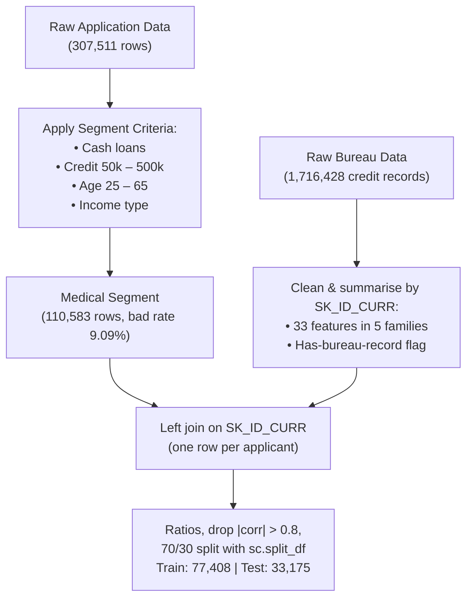
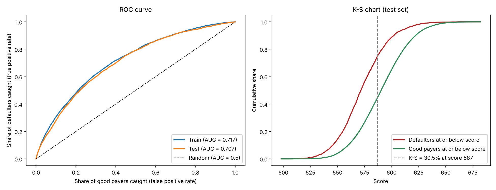
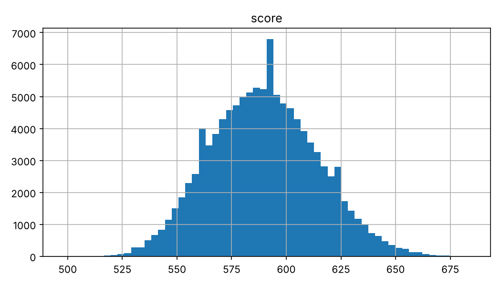
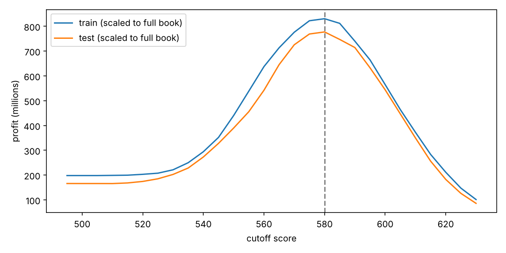

# IS453 Financial Analytics: Credit Scorecard Development
## Project Write-up: Combined Scorecard Notebook
**Academic Term:** IS453 Financial Analytics  
**Course Group:** Section 1, Group 7 (G1 - Group 7)  
**Lending Product Assignment:** **Medical Procedure Loans**  
**Code:** `IS453_G7_Scorecard_Combined.ipynb`

---

## Executive Summary

Group 7 has developed a credit scorecard for a new retail product: **Medical Procedure Loans**, which finance
out-of-pocket elective and semi-urgent medical costs such as dental restoration, fertility treatment, orthopaedic and
corrective surgery. The analysis runs end to end in one notebook and follows the techniques taught in the Week 9–11 labs.

1. **Segment Filtering & Data Integration:** 110,583 representative applications selected from 307,511 records
   (bad rate 9.09%), merged with 1,716,428 bureau credit records cleaned and summarised into 33 features per applicant.
2. **Screening & Grouping:** all 105 candidate variables screened by Information Value; coarse classing with
   `scorecardpy`, adjusted so that risk moves in one direction across bins.
3. **Logistic Regression & Discrimination:** 15 variables chosen by forward selection, with a **Test AUC of 0.707**
   (Gini 0.414) and a **K-S statistic of 30.5%**, close to the training results.
4. **Scaling (Week 11 lab):** **600 points at odds of 19:1 (5% probability of default), PDO = 20**.
5. **Cutoff, Pricing & Profitability:** profit-maximising cutoff at **580 points**, approving **64.8%** of applicants and
   lowering the approved bad rate from **9.09% to 5.21%**. A break-even interest rate is calculated for every score band
   as the basis for risk-based pricing.

> [!NOTE]
> This version replaces the group's first version (`credit_scorecard_medical.py`) on the **same segment**. The changes,
> and the reason for each, are listed in [Changes from the First Version](#changes-from-the-first-version).

---

## Component 1: Business Opportunity, Customer Segment & Product Context

### 1. The Market Opportunity
Insurance often leaves patients paying part of their medical bills themselves through co-payments, deductibles, claim
limits, or elective procedures that are not covered at all, such as:
- **Dental restoration and implants**
- **IVF and fertility treatment**
- **Elective orthopaedic and joint surgery**
- **Corrective and aesthetic surgery**

These costs arrive as a single, known bill that many patients cannot pay from savings. A fixed-instalment loan is cheaper
than revolving credit cards and predictable to repay. For the bank, demand is relatively steady because medical needs do
not follow the economic cycle closely, the purpose is specific (the amount matches a treatment quote), and partnering with
clinics gives a low-cost channel. Decisions are needed quickly at the clinic, which is where an automated scorecard adds
value.

### 2. How the Segment Uses the Product
- A **one-off cash loan** sized to the treatment cost, repaid in **fixed monthly instalments**.
- **Short to medium terms**: in the segment the median term is 15.5 months, against 20.7 months for all cash loans.
- **Moderate amounts**: median loan of 284,400, against 540,000 for all cash loans.
- Applied for close to the procedure date, often at the clinic.

### 3. Core Business Assumptions
1. **Unsecured instalment loan**, disbursed to the borrower or directly to the healthcare provider.
2. **Proxy segment:** the data has no loan-purpose field, so past cash-loan borrowers who match the filters are assumed to
   behave like future medical-procedure borrowers.
3. **Loss Given Default (LGD) of 70%:** unsecured lending with about 30% recovered.
4. **Product interest rate of 15% APR and cost of funds of 5%** (illustrative, used for the profitability analysis).
5. **TARGET = 1 (payment difficulties) is treated as a default**, which makes the profit estimates conservative.

---

## Component 2: Data Selection, Preparation & Bureau Merging

### 1. Data Selection Criteria (Week 10 Checkpoint)
- `NAME_CONTRACT_TYPE == 'Cash loans'` (instalment loans, excluding revolving credit).
- `50,000 <= AMT_CREDIT <= 500,000` (typical procedure cost range; excludes very small purchases and property- or car-sized loans).
- `25 <= AGE <= 65` (independent adults with elective or restorative medical needs).
- `NAME_INCOME_TYPE` $\in$ `['Working', 'Commercial associate', 'State servant', 'Pensioner']` (a regular income to repay from).
- Loan annuity known and total income above 0.

`ORGANIZATION_TYPE == 'Medicine'` is not used, because it describes the applicant's employer, not the loan's purpose.

### 2. Checkpoint Comparison Metrics
| Metric | Original Application Dataset | Medical Procedure Loan Segment | Variance / Rationale |
| :--- | :---: | :---: | :--- |
| **Total Rows** | 307,511 | **110,583** | Retains **36.0%** of the data; a robust sample size. |
| **Good Borrowers (0)** | 282,686 (91.93%) | **100,528 (90.91%)** | Most borrowers repay. |
| **Defaulted Borrowers (1)** | 24,825 (8.07%) | **10,055 (9.09%)** | **+1.02 points** in bad rate. |

| Filter step | Rows | Bad rate |
| :--- | :---: | :---: |
| Original data | 307,511 | 8.07% |
| 1. Cash loans | 278,232 | 8.35% |
| 2. + loan amount 50k–500k | 123,413 | 8.96% |
| 3. + age 25–65 | 110,596 | 9.09% |
| 4. + income type | 110,589 | 9.09% |
| 5. + annuity known, income > 0 | **110,583** | **9.09%** |

> [!NOTE]
> The higher bad rate comes mainly from the loan-amount filter. Among cash loans, 250k–500k loans have a 9.93% bad rate,
> while loans above 1m have 5.94%. The segment keeps mid-sized loans and removes the large, safer ones. Within the
> segment, bad rates fall steadily with age, from 12.28% for 25–29 year-olds to 5.56% for 55–65 year-olds.

### 3. Credit Bureau Cleaning & Aggregation
Because the bureau data has one row per credit (a median of 4 and up to 116 per applicant), joining it directly would
repeat applicants and create false extra "bad" rows. Each applicant's credits are therefore summarised into one row
(Option 3 from the data-merging module) and left-joined on `SK_ID_CURR`.

**Cleaning before summarising:**
- 17 records updated **after** the application date dropped (information the bank would not have had).
- 8,418 negative debts and 351 negative limits set to 0.
- 1,408 credits in other currencies (0.08%) flagged; no exchange rates are provided.

**33 features in five families:**
| Family | Examples |
| :--- | :--- |
| Account counts | total, active, closed, sold or bad-debt credits |
| Delinquency | overdue now, ever overdue, largest amount overdue, prolonged credits |
| Exposure | total and active credit and debt, utilisation, debt-to-credit |
| Credit mix | consumer, card, microloan and secured credits; number of credit types |
| History & recency | history length, months since latest credit, credits opened in the last 12 / 24 months |

**Applicants without bureau history:** counts and totals are set to 0, and ratios are left blank so that they get their
own "Missing" bin. A `HAS_BUREAU` flag is added. These applicants are riskier:

| | Applicants | Share | Bad rate |
| :--- | :---: | :---: | :---: |
| No bureau record | 16,822 | 15.2% | **11.31%** |
| Has bureau record | 93,761 | 84.8% | 8.70% |

### 4. Modelling Table & Train/Test Split
- **Derived variables:** day counts converted to years; ratios such as loan term (`AMT_CREDIT / AMT_ANNUITY`),
  credit-to-goods, credit-to-income and debt-to-income; `DAYS_EMPLOYED = 365243` (pensioners and unemployed) set to
  missing and flagged.
- **`ORGANIZATION_TYPE`** grouped from 58 values into 35 sectors.
- **Excluded:** `CODE_GENDER` (protected attribute), duplicate date fields and 6 columns with a single value.
- **Highly correlated variables (Week 9 lab):** 117 pairs with |correlation| > 0.8; the variable less correlated with
  TARGET is dropped in each pair (48 variables), mostly duplicate building statistics.
- **70/30 split with `sc.split_df`** (Week 11 lab): **77,408** training and **33,175** test applicants, both at 9.09%.

---

## Component 3: Screening & Grouping of Variables (WoE & IV)

### 1. Screening by Information Value (Week 10 lab)
Each of the 105 candidate variables was fine-classed into 20 equal-frequency bins (`pd.qcut`), using the course formulas:
$$\text{WoE}_j = \ln\left( \frac{\% \text{Goods}_j}{\% \text{Bads}_j} \right) \quad \text{and} \quad \text{IV} = \sum_j (\% \text{Goods}_j - \% \text{Bads}_j) \times \text{WoE}_j$$

| IV range | Predictive power | Variables |
| :--- | :--- | :---: |
| < 0.02 | Unpredictive (dropped) | 64 |
| 0.02 – 0.10 | Weak | 37 |
| 0.10 – 0.30 | Medium | 4 |

**41 variables pass.** The strongest are loan term (0.283), external score `EXT_SOURCE_1` (0.152), years employed
(0.134), bureau debt-to-credit (0.108), share of bureau credits active (0.100) and age (0.096).

### 2. Coarse Classing (Week 10 & Week 11 labs)
`sc.woebin` groups each variable into coarse bins with at least 5% of applicants each and a separate missing bin. Seven
numeric variables did not show a one-direction (monotonic) trend, so neighbouring bins whose bad rates crossed were
merged with `breaks_list` (Week 10 Ex Q3):

| Characteristic | Adjusted bin edges | Risk trend |
| :--- | :--- | :--- |
| `CREDIT_TO_GOODS` | 1.14, 1.25 | financing above the procedure price → riskier |
| `AMT_CREDIT` | 110k, 180k, 280k | larger loan → riskier |
| `AMT_ANNUITY` | 13k, 16k | larger instalment → riskier |
| `REGION_POPULATION_RELATIVE` | 0.021, 0.032 | more populated region → safer |
| `YEARS_BEGINEXPLUATATION_MEDI` | 0.977, 0.988 | newer building → safer |
| `BUR_MAX_CREDIT` | 100k, 2.45m | larger past credits elsewhere → safer |
| `TERM_MONTHS` | 10.5, 21.5 | **U-shaped** (kept as 3 bins) |

> [!IMPORTANT]
> **Loan term is U-shaped:** under 11 months 5.0% bad, 11–21 months 11.3%, 22 months or more 5.8%. Loans of about
> 10 months have only a 2.4% bad rate, which probably reflects a standard product. Short terms suit applicants who can
> afford large instalments, and long terms tend to be offered to applicants already seen as lower risk. The shape is kept
> (Week 10 DIY Q1 approach) because forcing one direction would discard most of the strongest variable's information.

After grouping, **37 variables keep IV ≥ 0.02**.

> [!NOTE]
> `scorecardpy` defines WoE as ln(% Bads / % Goods), the opposite sign to the Week 10 formula, so a *positive* WoE
> marks a *riskier* bin and the model's coefficients are positive. The IV is identical.

---

## Component 4: Logistic Regression & Model Performance

### 1. Variable Selection
1. WoE variables with |correlation| > 0.8 are reduced to one each (34 remain).
2. **Forward selection:** at each step, the variable that raises training Gini the most is added, as long as every
   coefficient stays above 0.1 (correct sign and a meaningful weight). Selection stops at 15 variables.

### 2. Model Parameters
`LogisticRegression` on the WoE values (Week 11 lab), trained on 77,408 applicants:

| Characteristic ($X_i$) | Coefficient ($\beta_i$) | IV |
| :--- | :---: | :---: |
| **Intercept ($\beta_0$)** | **-2.3042** | — |
| `YEARS_EMPLOYED_woe` | 0.5593 | 0.130 |
| `TERM_MONTHS_woe` | 0.6802 | 0.137 |
| `EXT_SOURCE_1_woe` | 0.6650 | 0.145 |
| `BUR_DEBT_TO_CREDIT_woe` | 0.5288 | 0.105 |
| `REGION_RATING_CLIENT_W_CITY_woe` | 0.8009 | 0.053 |
| `BUR_N_OPENED_12M_woe` | 1.0055 | 0.042 |
| `NAME_EDUCATION_TYPE_woe` | 0.7835 | 0.042 |
| `BUR_MAX_AMT_OVERDUE_woe` | 1.0065 | 0.028 |
| `YEARS_PHONE_CHANGE_woe` | 0.6210 | 0.053 |
| `OCCUPATION_TYPE_woe` | 0.4181 | 0.084 |
| `AMT_CREDIT_woe` | 0.7065 | 0.031 |
| `FLOORSMAX_AVG_woe` | 0.5674 | 0.033 |
| `BUR_SHARE_ACTIVE_woe` | 0.4193 | 0.097 |
| `NAME_FAMILY_STATUS_woe` | 0.5869 | 0.025 |
| `YEARS_ID_PUBLISH_woe` | 0.4468 | 0.037 |

> [!IMPORTANT]
> **Key Diagnostic Highlights for Presentation:**
> - **Sign Consistency:** all coefficients are positive, which with `scorecardpy`'s WoE means riskier bins correctly
>   raise the log-odds of default.
> - **Balanced inputs:** 9 application characteristics, 2 loan characteristics (term, amount) and 4 bureau characteristics.

### 3. Discrimination & Model Performance (Train vs Test)
| Evaluation Metric | Training Set (70%) | Testing Holdout (30%) | Interpretation |
| :--- | :---: | :---: | :--- |
| **ROC - AUC** | 0.7166 | **0.7072** | Solid discrimination for application data. |
| **Gini** | 0.4333 | **0.4144** | Small train–test gap: limited overfitting. |
| **Kolmogorov-Smirnov (K-S)** | 32.14% | **30.47%** | Widest separation of goods and bads at score **587**. |
| **Calibration** | — | — | Expected defaults from scores match actual defaults at every cutoff (e.g. 2,540 vs 2,542 at 580). |

**Reading the ROC curve (left).** The scorecard is used to catch defaulters, so the chart starts from the lowest scores
and works upwards. The y-axis is the share of all defaulters caught so far, and the x-axis is the share of good payers
caught along with them. A useless score would follow the dashed diagonal (catching defaulters no faster than good
payers). The curve bows well above it: for example, by the time the lowest-scoring 20% of good payers have been
caught, almost half of all defaulters have been caught too. The **AUC (area under the curve)** sums this up: 0.5 is random, 1.0 is perfect, and 0.707 is solid for
application data. The training and test curves almost overlap, which confirms the model is not overfitting.

**Reading the K-S chart (right).** For every score, the red line is the share of all defaulters scoring at or below it,
and the green line the share of all good payers. Defaulters pile up at low scores, so the red line rises first. The
**K-S statistic is the widest vertical gap between the lines: 30.5% at score 587**. At that score, about 75% of defaulters
but only about 45% of good payers score at or below it. It is the point of strongest separation, and it lies close to the chosen cutoff
of 580.

*Score distribution of all applicants (Week 11 lab): most score between about 550 and 620.*

---

## Component 5: Model Tuning

| Option | Variables | Train Gini | Test Gini | Wrong-sign coefficients | Average predicted PD |
| :--- | :---: | :---: | :---: | :---: | :---: |
| **Selected variables, adjusted bins (chosen)** | 15 | 0.433 | **0.414** | 0 | 9.11% |
| Selected variables, automatic `sc.woebin` bins | 15 | 0.439 | 0.421 | 0 | 9.11% |
| First 5 selected variables | 5 | 0.372 | 0.354 | 0 | 9.09% |
| First 10 selected variables | 10 | 0.417 | 0.400 | 0 | 9.10% |
| All 34 candidate variables | 34 | 0.456 | 0.440 | 3 | 9.12% |
| Selected + `class_weight='balanced'` (Week 9 lab) | 15 | 0.433 | 0.414 | 0 | 44.25% |

> [!TIP]
> **Tuning Decisions:**
> - Gains flatten after about 10 variables, so 15 is a reasonable stopping point.
> - Automatic bins gain 0.007 Gini but follow noise in the data; the adjusted bins each have a business explanation and
>   should be more stable on new applicants.
> - Using all 34 variables gives three wrong-sign coefficients, so their points would contradict their own bins.
> - `class_weight='balanced'` leaves the ranking unchanged but inflates the predicted PD to 44% (actual 9.09%), which
>   breaks the 600 = 5% PD scaling and the expected-default calculation.

---

## Component 6: Scorecard Scaling, Cutoff Selection & Profitability

### 1. Scaling Mathematics (Week 11 lab)
- $\text{Target Score} = 600$ at $\text{odds (bad:good)} = 1:19$, i.e. a 5% probability of default; $\text{PDO} = 20$.
- $\text{Factor} = \frac{\text{PDO}}{\ln(2)} = \frac{20}{0.69315} = \mathbf{28.8539}$.
- $\text{Offset} = 600 + \text{Factor} \times \ln(1/19) = 600 - 28.8539 \times 2.94444 = \mathbf{515.0414}$.
- Built with `sc.scorecard(bins, lr, ..., points0=600, odds0=1/19, pdo=20, basepoints_eq0=True)`, which spreads the
  base points across the 15 characteristics. Scores range from 498 to 684.

### 2. Complete Scorecard Points Table
Share of applicants and bad rate are from the training set.

| Characteristic | Attribute | Share of applicants | Bad rate | Points |
| :--- | :--- | :---: | :---: | :---: |
| **Years employed (`YEARS_EMPLOYED`)** | Missing (pensioner / not employed) | 18.0% | 5.6% | **47** |
|  | < 3.5 | 34.3% | 12.4% | **33** |
|  | 3.5 – 5.5 | 14.2% | 10.7% | **36** |
|  | 5.5 – 11 | 20.6% | 7.9% | **41** |
|  | ≥ 11 | 12.9% | 5.3% | **48** |
| **Loan term, months (`TERM_MONTHS`)** | < 10.5 | 21.3% | 5.0% | **51** |
|  | 10.5 – 21.5 | 63.2% | 11.3% | **34** |
|  | ≥ 21.5 | 15.6% | 5.8% | **48** |
| **External score (`EXT_SOURCE_1`)** | Missing | 57.2% | 9.6% | **38** |
|  | < 0.22 | 5.3% | 18.0% | **24** |
|  | 0.22 – 0.42 | 12.7% | 10.8% | **35** |
|  | 0.42 – 0.5 | 5.3% | 7.6% | **43** |
|  | 0.5 – 0.64 | 8.7% | 6.1% | **47** |
|  | ≥ 0.64 | 10.9% | 3.4% | **59** |
| **Bureau debt-to-credit (`BUR_DEBT_TO_CREDIT`)** | Missing (no bureau record) | 15.6% | 11.1% | **35** |
|  | < 0.15 | 37.3% | 6.5% | **44** |
|  | 0.15 – 0.45 | 23.7% | 8.1% | **41** |
|  | 0.45 – 0.75 | 15.8% | 11.4% | **35** |
|  | ≥ 0.75 | 7.6% | 15.9% | **29** |
| **Region rating (`REGION_RATING_CLIENT_W_CITY`)** | Rating 1 (best) | 7.6% | 5.1% | **53** |
|  | Rating 2 | 77.4% | 8.7% | **40** |
|  | Rating 3 (worst) | 15.0% | 13.0% | **29** |
| **Credits opened in last 12 months (`BUR_N_OPENED_12M`)** | 0 | 50.4% | 8.1% | **42** |
|  | 1 | 26.0% | 8.4% | **41** |
|  | 2 | 13.2% | 10.3% | **35** |
|  | 3 or more | 10.4% | 14.0% | **25** |
| **Education (`NAME_EDUCATION_TYPE`)** | Academic degree, Higher education | 20.2% | 5.9% | **49** |
|  | Incomplete higher, Secondary / secondary special, Lower secondary | 79.8% | 9.9% | **37** |
| **Largest amount ever overdue (`BUR_MAX_AMT_OVERDUE`)** | Missing (never recorded) | 40.9% | 9.7% | **37** |
|  | < 1,500 | 38.8% | 7.5% | **45** |
|  | 1,500 – 15,500 | 14.8% | 10.8% | **33** |
|  | ≥ 15,500 | 5.5% | 11.5% | **31** |
| **Years since phone change (`YEARS_PHONE_CHANGE`)** | < 3.2 | 64.2% | 10.4% | **36** |
|  | 3.2 – 5.6 | 24.5% | 7.2% | **43** |
|  | ≥ 5.6 | 11.4% | 5.7% | **48** |
| **Occupation (`OCCUPATION_TYPE`)** | Missing | 31.2% | 7.1% | **42** |
|  | Accountants, Secretaries, Core staff, HR staff, High skill tech staff, Private service staff, Medicine staff, Managers, IT staff | 23.3% | 6.8% | **43** |
|  | Sales staff, Realty agents, Cooking staff | 13.3% | 10.5% | **37** |
|  | Cleaning staff, Laborers, Drivers, Waiters/barmen staff, Security staff, Low-skill Laborers | 32.2% | 12.1% | **35** |
| **Loan amount (`AMT_CREDIT`)** | < 110,000 | 6.0% | 5.8% | **49** |
|  | 110,000 – 180,000 | 11.9% | 6.9% | **45** |
|  | 180,000 – 280,000 | 29.7% | 8.6% | **40** |
|  | ≥ 280,000 | 52.5% | 10.2% | **36** |
| **Building floors, normalised (`FLOORSMAX_AVG`)** | Missing | 52.4% | 10.2% | **37** |
|  | < 0.16 | 11.0% | 9.5% | **38** |
|  | 0.16 – 0.24 | 20.6% | 8.1% | **41** |
|  | 0.24 – 0.36 | 10.8% | 6.9% | **44** |
|  | ≥ 0.36 | 5.2% | 5.5% | **48** |
| **Share of bureau credits active (`BUR_SHARE_ACTIVE`)** | Missing (no bureau record) | 15.3% | 11.1% | **36** |
|  | < 0.3 | 33.1% | 6.2% | **44** |
|  | 0.3 – 0.34 | 8.6% | 7.3% | **42** |
|  | 0.34 – 0.52 | 19.9% | 9.0% | **39** |
|  | ≥ 0.52 | 23.0% | 12.6% | **34** |
| **Family status (`NAME_FAMILY_STATUS`)** | Widow | 5.5% | 5.9% | **47** |
|  | Married | 60.1% | 8.5% | **40** |
|  | Separated | 7.3% | 9.1% | **39** |
|  | Single / not married, Civil marriage | 27.1% | 11.0% | **35** |
| **Years since ID document issued (`YEARS_ID_PUBLISH`)** | < 1.5 | 6.8% | 12.5% | **34** |
|  | 1.5 – 7 | 29.1% | 10.4% | **37** |
|  | 7 – 11.5 | 35.3% | 9.0% | **39** |
|  | ≥ 11.5 | 28.7% | 7.0% | **42** |

### 3. Cutoff Optimization & Profitability Analysis
*Profit per good loan = interest at 15% APR minus 5% cost of funds over the loan's own amount and term. Loss per bad
loan = 70% of the loan amount. The cutoff is chosen on the training set and checked on the test set.*

| Cutoff Score | Approval Rate (%) | Expected Defaults | Actual Defaults | Bad Rate in Approved (%) |
| :---: | :---: | :---: | :---: | :---: |
| 560 | 88.9% | 4,933 | 4,978 | 7.24% |
| 570 | 78.8% | 3,744 | 3,791 | 6.22% |
| **580 (Optimal)** | **65.0%** | **2,540** | **2,542** | **5.05%** |
| 590 | 49.4% | 1,544 | 1,557 | 4.07% |
| 600 | 34.2% | 833 | 838 | 3.17% |

*Training set, 77,408 applicants. Expected defaults use odds (good:bad) = 19 × 2^((score − 600)/20), as in the Week 11 lab.*

**Profit at every cutoff** (test set, 33,175 applicants; amounts in millions of the data's currency):

| Cutoff Score | Approval Rate (%) | Approved Loans | Defaulted Loans | Bad Rate in Approved (%) | Net Interest from Good Loans | Default Losses | **Net Profit** |
| :---: | :---: | :---: | :---: | :---: | :---: | :---: | :---: |
| Approve all | 100.0% | 33,175 | 3,017 | 9.09% | 716.6 | 666.8 | **49.8** |
| 540 | 98.5% | 32,681 | 2,849 | 8.72% | 707.8 | 625.8 | **81.9** |
| 550 | 95.5% | 31,689 | 2,619 | 8.26% | 687.9 | 570.9 | **117.0** |
| 560 | 89.2% | 29,587 | 2,228 | 7.53% | 643.2 | 480.6 | **162.6** |
| 570 | 78.7% | 26,109 | 1,651 | 6.32% | 568.0 | 350.3 | **217.7** |
| **580 (Optimal)** | **64.8%** | **21,484** | **1,120** | **5.21%** | **465.2** | **231.9** | **233.2** |
| 590 | 49.5% | 16,427 | 678 | 4.13% | 351.7 | 137.3 | **214.4** |
| 600 | 34.2% | 11,340 | 363 | 3.20% | 236.7 | 73.5 | **163.2** |
| 610 | 21.1% | 7,007 | 185 | 2.64% | 142.4 | 37.5 | **105.0** |
| 620 | 11.6% | 3,841 | 98 | 2.55% | 74.5 | 19.7 | **54.8** |

*Profit by cutoff, with training and test results each scaled up to the full applicant base. Both peak at 580.*

**How to read it.** "Net interest from good loans" is the interest earned on approved loans that are repaid, after the
bank's own funding cost. "Default losses" are 70% of each approved loan that defaults. Raising the cutoff removes bad
loans faster than good ones at first, so losses fall more than interest and profit rises. Past 580, the scorecard starts
turning away mostly good payers, so interest falls faster than losses and profit drops. Below about 560, defaults eat up
almost all the interest.

> [!TIP]
> **Executive Trade-off:** with a 70% loss on each default, approving everyone barely makes money. A cutoff of 580
> removes most of the losses and raises profit about 4.7 times, at the cost of declining about one in three applicants.
> If the bank prioritises market share, a cutoff of 560–570 approves more applicants for somewhat less profit.

### 4. Confusion Matrix at Recommended Cutoff (580)
*Evaluation on 33,175 test applicants (Positive = Good Repayer, Negative = Defaulter), as in the Week 11 lab:*

| | **Predicted Good (Score $\ge 580$)** | **Predicted Defaulter (Score $< 580$)** | Total |
| :--- | :---: | :---: | :---: |
| **Actual Good (0)** | **20,364 (TP)** | 9,794 (FN) | 30,158 |
| **Actual Defaulter (1)** | 1,120 (FP) | **1,897 (TN)** | 3,017 |
| **Total** | 21,484 | 11,691 | 33,175 |

| Measure | Value | Meaning |
| :--- | :---: | :--- |
| **Accuracy** | **67.10%** | share of applicants classified correctly |
| **Error Rate** | **32.90%** | share classified wrongly (1 − accuracy) |
| **Sensitivity / Recall (goods)** | **67.52%** | share of good payers who are approved |
| **Specificity (defaulters)** | **62.88%** | share of defaulters declined before receiving a loan |
| **Precision** | **94.79%** | share of approved applicants who repay |
| **F-1 Score (goods)** | **78.87%** | balance of precision and recall: 2 × P × R / (P + R) |

> [!NOTE]
> Accuracy (67%) is lower than simply approving everyone would give (91%, since 91% of applicants repay). The cutoff is
> chosen to maximise profit, not accuracy. A missed defaulter costs 70% of the loan, while a declined good payer costs
> only the lost interest, so the scorecard deliberately declines some good payers to avoid defaulters. The F-1 score of
> 0.79 reflects this trade-off: precision is very high (95%), but about one in three good payers is declined.

### 5. Risk-Based Pricing Structure
The break-even APR is the lowest rate at which a score band's interest covers its default losses and cost of funds
(test set):

| Tier | Score Range | Applicants (test) | Bad Rate | Break-even APR | Indicative APR | Origination Policy & Workflow |
| :--- | :---: | :---: | :---: | :---: | :---: | :--- |
| **Tier 1 (Prime)** | ≥ 640 | 771 | 1.69% | 6.8% | **10.0%** | Automatic approval; funds paid directly to the clinic. |
| **Tier 2 (Near Prime)** | 620 – 639 | 3,070 | 2.77% | 7.9% | **11.0%** | Automatic approval with standard documents (ID, payslip, clinic quote). |
| **Tier 3 (Standard)** | 600 – 619 | 7,499 | 3.53% | 8.4% | **11.5%** | Approve after an income check (payslips) and the clinic's treatment plan. |
| **Tier 4 (Higher Risk)** | 580 – 599 | 10,144 | 7.46% | 12.0% | **15.0%** | Approve after a full review: income, 3 months of bank statements, treatment plan; consider a lower amount or shorter term. |
| **Decline** | < 580 | 11,691 | 16.23% | 22.0% | — | Decline, or refer for a co-signer or security. |

- **Break-even APR** is calculated from each band's actual bad rate, loan amounts and terms.
- **Indicative APR** = break-even + a 3-point margin for operating costs and profit, rounded up to the nearest 0.5%.
  The margin is a business decision.
- Applicants below 580 would need about 22% just to break even, above the 15% product rate, which is why they are declined.
- **Origination policy** adds more checks as the score falls. The best tiers are approved instantly, which suits a
  decision made at the clinic; Tier 4 gets a manual review because its bad rate (7.5%) is closest to the decline band.

---

## Component 7: Scorecard Walkthrough with Example Applicants

Three real test-set applicants at the 10th, 50th and 90th percentile of score, scored with `sc.scorecard_ply` (Week 11
Ex Q1 style).

| Characteristic | Applicant 101744 | Pts | Applicant 100856 | Pts | Applicant 100928 | Pts |
| :--- | :--- | :---: | :--- | :---: | :--- | :---: |
| Years employed | 0.3 | 33 | 11.9 | 48 | 9.3 | 41 |
| Loan term (months) | 17.7 | 34 | 19.0 | 34 | 10.0 | 51 |
| External score | Missing | 38 | 0.56 | 47 | 0.29 | 35 |
| Bureau debt-to-credit | Missing | 35 | Missing | 35 | 0.20 | 41 |
| Region rating | 2 | 40 | 2 | 40 | 2 | 40 |
| Credits opened, last 12 months | 0 | 42 | 0 | 42 | 1 | 41 |
| Education | Secondary | 37 | Secondary | 37 | Higher education | 49 |
| Largest amount ever overdue | Missing | 37 | Missing | 37 | 2,617 | 33 |
| Years since phone change | 0.2 | 36 | 7.0 | 48 | 2.9 | 36 |
| Occupation | Missing | 42 | High skill tech staff | 43 | Accountants | 43 |
| Loan amount | 364,896 | 36 | 364,896 | 36 | 95,940 | 49 |
| Building floors | Missing | 37 | Missing | 37 | Missing | 37 |
| Share of bureau credits active | 1.0 | 34 | Missing | 36 | 0.2 | 44 |
| Family status | Single | 35 | Single | 35 | Married | 40 |
| Years since ID issued | 13.1 | 42 | 1.1 | 34 | 13.8 | 42 |
| **Total Score** | | **558** | | **589** | | **622** |
| **Decision** | | **Decline** | | **Approve (580–599)** | | **Approve (620–639)** |

- **Applicant 101744 (558, declined):** four months in the current job, a mid-length term and a very recent phone change.
  This applicant actually repaid, an example of a good payer turned away by the cutoff.
- **Applicant 100856 (589, approved):** 12 years of employment and a good external score outweigh a mid-length term.
- **Applicant 100928 (622, approved):** a short term, a small loan and higher education outweigh a weak external score
  and a past overdue amount.

---

## Changes from the First Version

The segment is unchanged. The table summarises what changed from `credit_scorecard_medical.py` and why.

| # | Area | First version | This version | Reason |
| :---: | :--- | :--- | :--- | :--- |
| 1 | Code | Python script | notebook following the Week 9–11 labs | matches the techniques taught; each step can be explained against the labs |
| 2 | Bureau cleaning | not applied | post-application records dropped, negative amounts set to 0, foreign currency flagged | negative debts would make applicants look safer; later records are leakage |
| 3 | Bureau features | 7 summaries | 33 features + `HAS_BUREAU` | adds signals now in the model: largest overdue amount, recent credits, share of active credits |
| 4 | No bureau record | debt ratio became 0, placing them in the lowest-debt bin (73 points) | ratio left blank, own Missing bin (35 points vs 44 for low debt) | these applicants are riskier (11.31% vs 8.70%) |
| 5 | Screening | IV reported for 8 selected variables | Week 9 correlation rule, then IV for all 105 candidates | the brief asks for screening of the available variables (Week 10 lab) |
| 6 | Binning | fixed bin edges; payment-rate points 68 / 70 / 61 / 79 | `sc.woebin` + `breaks_list`; monotonic except the explained U-shape | one-direction bins are easier to justify and more stable |
| 7 | Variable selection | fixed set of 8 | forward selection, 15 variables, coefficient rule | adds predictive variables while keeping every coefficient meaningful |
| 8 | Model fitting | statsmodels coefficients reported, sklearn coefficients used for points | one sklearn `LogisticRegression` | reported and applied coefficients are the same |
| 9 | Scaling | 600 = 50:1 | 600 = 19:1 (5% PD) | matches the Week 11 lab (`odds0 = 1/19`); scores are not comparable between versions |
| 10 | Split | `train_test_split` | `sc.split_df` | Week 11 lab function; same sizes |
| 11 | Performance | AUC 0.684, K-S 26.9% | AUC 0.707, Gini 0.414, K-S 30.5%, PCC measures, expected vs actual defaults | better discrimination and calibration checks taught in Week 11 |
| 12 | Tuning | — | 6 options compared | the brief asks for the tuning approach and results |
| 13 | Profit | average loan of 250,000, 18% margin, 10,000-applicant cohort | each loan's own amount and term, 15% APR less 5% funding, 70% LGD | links profit to an interest rate and to each applicant's loan |
| 14 | Pricing | 3 tiers at 6.5% / 8.5% / 12% | 4 tiers priced from each band's break-even APR, with an origination policy for each | tier rates can be justified from each band's actual bad rate |
| 15 | Examples | 3 illustrative profiles | 3 real test applicants | shows the scorecard on actual data values |
| 16 | Consistency | some dossier tables differed from the script's outputs | every number from one notebook run | one consistent set of results |

### Explanation of the Changes

**Lab-style notebook**
- **What:** the whole analysis runs in one notebook using the same tools as the Week 9–11 labs.
- **Why:** the brief requires the techniques taught in the course. Matching the lab code makes each step easy to
  recognise and easy for every member to explain.

**Bureau data cleaned and expanded (7 → 33 features)**
- **What:** before each applicant's credits at other lenders are summarised, impossible values (negative debts) are set
  to 0 and records dated after the application are removed. The summary now covers counts, overdue history, debt levels,
  types of credit and recent borrowing.
- **Why:** negative debts would make applicants look safer than they are, and information from after the application
  was not available when the bank decided (leakage). The extra features add useful signals to the model, such as recent
  credits and past overdue amounts.

**Applicants with no bureau record**
- **What:** they now get their own "Missing" group.
- **Why:** previously their debt ratio worked out to 0, which placed them in the lowest-debt, best-scoring group. They
  are in fact riskier (11.3% bad rate vs 8.7%), so they should score lower, and now they do.

**All variables screened by IV**
- **What:** all 105 candidate variables are tested for how well they separate goods from bads, after removing
  near-duplicate variables (Week 9).
- **Why:** the brief asks for screening of the available variables. Testing them all shows why each one was kept or
  dropped, and it found strong variables not used before, such as loan term.

**Binning with `sc.woebin`, adjusted to one direction**
- **What:** variables are grouped into bins automatically, then neighbouring bins are merged where risk went up and down.
- **Why:** a pattern that rises or falls steadily is easier to justify (for example, longer employment → safer). Loan term
  is genuinely U-shaped (short and long loans are safer than mid-length ones), so it is kept that way with an explanation.

**15-variable model chosen step by step**
- **What:** variables are added one at a time, keeping whichever improves the model most. Any step that gives a variable
  the wrong sign or almost no weight is rejected.
- **Why:** this adds the most useful information while keeping every variable meaningful and explainable.

**Scaling changed to 600 = 19:1**
- **What:** a score of 600 now means odds of 19 goods to 1 bad (a 5% chance of default), and every 20 points doubles the odds.
- **Why:** this is the setting used in the Week 11 lab. Scores from the two versions cannot be compared directly.

**Better performance (AUC 0.707, K-S 30.5%)**
- **What:** the new model separates goods from bads better than the first version (AUC 0.684, K-S 26.9%), and it checks
  that the predicted number of defaults matches the actual number.
- **Why:** the gain comes from the richer bureau features and the wider set of variables. Because predicted and actual
  defaults match closely, the scores can be trusted as probabilities.

**Profit model based on each applicant's own loan**
- **What:** profit is calculated loan by loan: interest at 15% minus the 5% funding cost on good loans, and 70% of the
  loan lost on bad loans.
- **Why:** the first version used one average loan size and a flat margin not tied to an interest rate. Using each loan's
  real amount and term gives a more realistic profit figure.

**Cutoff of 580**
- **What:** applicants scoring 580 or more are approved: 64.8% of applicants, with a bad rate of 5.21%.
- **Why:** 580 gives the highest profit on both the training and test data. A lower cutoff is an option if the bank
  prefers more customers over profit.

**Pricing tiers from break-even rates, with an origination policy**
- **What:** each score band's minimum interest rate is calculated from its actual default rate, and a margin is added.
  Each tier also has an approval process: instant approval for the best tiers, extra checks for riskier ones.
- **Why:** the first version's rates were set in advance and did not match its profit model. Now every rate can be
  justified from the data.

**Additions**
- **Tuning comparison:** shows the final model was chosen over the alternatives for clear reasons.
- **Profit at every cutoff:** shows the trade-off between approving more applicants and losing more to defaults.
- **Error rate, specificity and F-1:** fuller measures of the cutoff's decisions, explaining why accuracy is deliberately
  lower than approving everyone.
- **Charts:** ROC/K-S, score distribution and profit curve, ready for the slides.
- **Real applicant examples:** show the scorecard working on actual data.

---

## Limitations & Risks
- **Proxy segment:** nothing in the data identifies medical-procedure loans.
- **Higher-risk segment:** 9.09% bad rate against 8.07% overall, driven by mid-sized loans and younger borrowers.
- **External score missing for 57%** of applicants, and it is a score the bank cannot explain.
- **No reject inference:** outcomes are only known for previously approved applicants.
- **U-shaped loan term** may partly reflect the bank's past product and pricing choices rather than borrower risk.
- **Profit figures depend on the assumptions** (APR, cost of funds, LGD) and are measured on the 30% test set.
- **Fairness:** gender is excluded, but family status, education and region could act as proxies and should be reviewed.
- **Monitoring:** the score distribution should be tracked after launch (population stability) and the model refreshed if it drifts.

---

## 15-Minute Final Presentation Slide Deck Structure
*(File to submit: `G1 - Group 7 Presentation.pdf`, with section and group number on the title slide. No code or
screenshots on the slides.)*

| Slide # | Slide Title | Visual Assets to Use | Time & Core Message | Speaker |
| :---: | :--- | :--- | :--- | :---: |
| **1** | **Title:** Credit Scorecard for Medical Procedure Loans | Section 1, Group 7; team names | 0:15 — Team and project mission. | 1 |
| **2** | **Business Opportunity & Product** | Simple patient → clinic → bank financing diagram; 3 product facts (one-off cost, fixed instalments, decision at the clinic) | 1:15 — Why patients need financing, how they use the loan, key business assumptions (unsecured, 70% LGD, proxy segment). | 1 |
| **3** | **Segment Selection & Checkpoint** | Funnel 307,511 → 110,583; checkpoint table; loan-size bad-rate bars | 1:10 — The five filters and why; bad rate 9.09% vs 8.07%, driven by mid-sized loans and younger borrowers. | 2 |
| **4** | **Bureau Integration & Data Preparation** | One-to-many → one-row diagram; 5 feature families; thin-file table (11.31% vs 8.70%) | 1:05 — Option 3 merge, cleaning (leakage, negative debts), no-bureau applicants kept as their own group; 70/30 split. | 2 |
| **5** | **Variable Screening (IV)** | IV bar chart of the top variables with the 0.02 / 0.1 / 0.3 bands | 1:00 — 105 candidates screened, 41 pass; the strongest predictors and what they mean. | 3 |
| **6** | **Grouping & the Loan-Term Pattern** | WoE chart for one monotonic variable (e.g. years employed) and the U-shaped loan term | 1:10 — Coarse classing with at least 5% per bin, one-direction trends, and why the loan-term U-shape is kept. | 3 |
| **7** | **Logistic Regression & Variable Selection** | Forward-selection path (Gini by step); coefficient table | 1:00 — 15 variables, all coefficients correct sign; mix of application, loan and bureau characteristics. | 4 |
| **8** | **Model Performance** | ROC and K-S chart (`g7_roc_ks_curves.png`); train vs test table (AUC 0.707, Gini 0.414, K-S 30.5%) | 1:00 — Solid discrimination, small train–test gap, well-calibrated scores. | 4 |
| **9** | **Model Tuning** | Tuning comparison table (6 options) | 0:50 — Why 15 variables, adjusted bins and no class weighting were chosen. | 4 |
| **10** | **Scorecard Scaling & Points** | Scaling formula (600 = 19:1, PDO 20); excerpt of the points table (3–4 characteristics) | 0:50 — How log-odds become additive points; how to read the scorecard. | 5 |
| **11** | **Cutoff & Profitability** | Profit curve (`g7_profit_curve.png`); profit-by-cutoff table; confusion matrix with accuracy, error rate and F-1 | 1:15 — Cutoff 580: 64.8% approved, bad rate 5.21%, profit about 4.7 times approve-all; the market-share trade-off. | 5 |
| **12** | **Risk-Based Pricing** | 4-tier pricing table with origination policy | 0:45 — Below 580 needs ~22% to break even, so decline; better tiers get lower rates and faster approval. | 5 |
| **13** | **Scorecard Walkthrough** | Side-by-side points for the three applicants (558 / 589 / 622) | 1:15 — Scoring real applicants step by step; the declined applicant who repaid shows the cost of a cutoff. | 6 |
| **14** | **Limitations, Risks & Conclusion** | Short checklist: proxy segment, missing external score, no reject inference, fairness review, monitoring | 0:50 — What to watch after launch; recommendation to adopt the scorecard. | 6 / Team |

> [!TIP]
> Planned speaking time is **13:40**, leaving about a minute for transitions within the 15-minute limit. Each member
> presents at least one component, as the brief requires. Charts come from the notebook (WoE plots, score
> distribution, profit curve) or can be redrawn from the tables in this write-up.

---

*To reproduce the results, place `IS453 Group Assignment - Application Data.csv` and
`IS453 Group Assignment - Bureau Data.csv` in the same folder as `IS453_G7_Scorecard_Combined.ipynb`, run the first cell
(it installs `pandas==2.1.1` and `scorecardpy==0.1.9.7`), restart the kernel, and run all cells. The notebook saves
`g7_iv_fine_classing.csv`, `g7_final_bins_and_points.csv` and `g7_scorecard_points.csv`, and the charts
`g7_roc_ks_curves.png`, `g7_score_distribution.png` and `g7_profit_curve.png` used in this write-up.*
