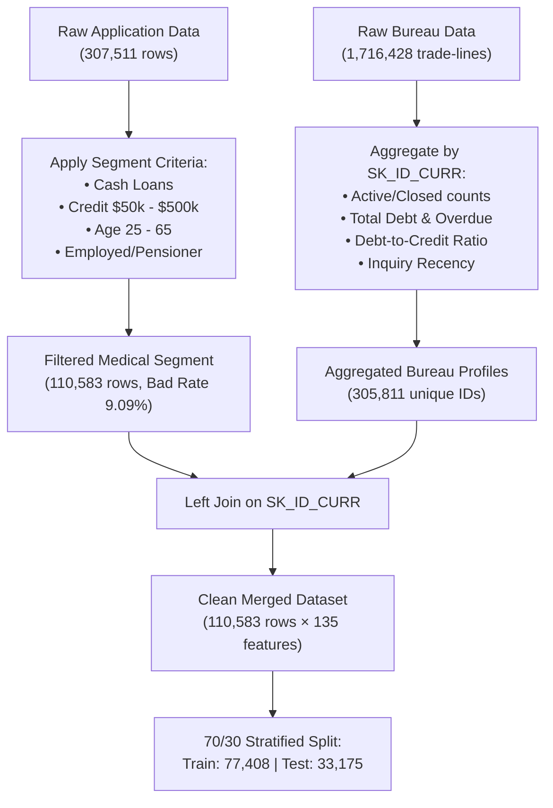

# IS453 Financial Analytics: Credit Scorecard Development
## Project Dossier & Presentation Blueprints
**Academic Term:** IS453 Financial Analytics  
**Course Group:** Section 1, Group 7 (G1 - Group 7)  
**Lending Product Assignment:** **Medical Procedure Loans**  
**Deliverable File:** `G1 - Group 7 Presentation.pdf` (Week 13 Submission)

---

## Executive Summary

As financial analytics consultants hired by the bank, Group 7 has developed an end-to-end predictive **Credit Scorecard** for a new retail credit offering: **Medical Procedure Loans**. This product is designed to finance out-of-pocket, elective, and semi-urgent medical expenses (e.g., dental restorations, fertility treatments, elective orthopedic surgeries, and aesthetic procedures).

Following the rigorous credit risk modeling methodologies taught in IS453, the solution incorporates:
1. **Segment Filtering & Data Integration:** Targeted extraction of 110,583 representative loan applications from 307,511 records, merged with 1.7+ million bureau trade-lines aggregated by `SK_ID_CURR`.
2. **Coarse Classing & WoE Transformation:** Monotonic binning across 8 demographic, financial, and credit bureau dimensions with Laplace smoothing.
3. **Logistic Regression & Discrimination:** Statistically robust model ($p < 0.001$, VIF $< 1.60$) achieving a **Test AUC of 0.6843** and a **Kolmogorov-Smirnov (K-S) statistic of 26.88%** with zero holdout overfitting.
4. **Course Standard Scaling:** Scaled to **Target Score 600 at 50:1 odds** with **PDO = 20** ($\text{Factor} \approx 28.85$, $\text{Offset} \approx 487.12$).
5. **Profitability & Pricing Optimization:** Profit-maximizing cutoff determined at **530 points**, achieving an **approval rate of 93.67%**, containing approved default risk to **8.15%**, and yielding a projected **net profit of $253.66 Million** per 10,000 applicant annual cohort.

---

## Component 1: Business Opportunity, Customer Segment & Product Context

### 1. The Market Opportunity
Out-of-pocket medical expenditures represent an acute liquidity strain for retail consumers. Public and private medical insurance policies typically impose copayments, deductibles, or completely exclude high-value elective procedures such as:
- **Dental reconstruction & implants:** \$3,000 – \$25,000
- **IVF & fertility cycles:** \$12,000 – \$40,000
- **Elective orthopedic & joint surgeries:** \$15,000 – \$45,000
- **Aesthetic & corrective surgeries:** \$5,000 – \$30,000

Patients require immediate financing with predictable, fixed monthly instalments rather than relying on high-interest credit cards (24%+ APR) or liquidation of long-term savings.

### 2. Core Business Assumptions
1. **Unsecured Term Loan Structure:** Financed as fixed-term personal cash loans disbursed directly to certified healthcare providers or borrowers, repayable over 12 to 48 months.
2. **Target Demographics:** Working-age adults aged 25 to 65 with steady income streams (employed, commercial professionals, civil servants, and stable pensioners).
3. **Loss Given Default (LGD):** As medical loans are unsecured personal exposures, recovery rates average 30%, resulting in an assumed **LGD of 70%**.
4. **Funding & Revenue Structure:** The bank operates at a net interest and fee margin of approximately 18% over the multi-year loan lifecycle across risk-based pricing tiers (6.5% – 12.0% APR).

---

## Component 2: Data Selection, Preparation & Bureau Merging

### 1. Data Selection Criteria (Week 10 Checkpoint Deliverable)
To isolate applicants representative of Medical Procedure Loans from the generic dataset:
- `NAME_CONTRACT_TYPE == 'Cash loans'` (Term instalment loans, excluding revolving credit cards).
- `50,000 <= AMT_CREDIT <= 500,000` (Eliminates retail micro-purchases <\$50k and luxury/mortgage exposures >\$500k).
- `25 <= AGE <= 65` (Captures independent adults with elective/restorative medical needs).
- `NAME_INCOME_TYPE` $\in$ `['Working', 'Commercial associate', 'State servant', 'Pensioner']` (Excludes unemployed applicants and non-income students).
- Valid, non-null loan annuity and positive total income.

### 2. Checkpoint Comparison Metrics
| Metric | Original Application Dataset | Filtered Medical Loan Segment | Variance / Rationale |
| :--- | :---: | :---: | :--- |
| **Total Rows** | 307,511 | **110,583** | Retains **35.96%** of total data; robust sample size. |
| **Good Borrowers (0)** | 282,686 (91.93%) | **100,528 (90.91%)** | Majority repay reliably. |
| **Defaulted Borrowers (1)** | 24,825 (8.07%) | **10,055 (9.09%)** | **+1.02% increase** in bad rate. |

> [!NOTE]
> The modest increase in bad rate (+1.02%) is economically realistic: mid-sized unsecured personal cash loans carry slightly higher inherent risk than large collateralized property loans.

### 3. Credit Bureau Aggregation Strategy
Because the Bureau dataset contains multiple historical borrowing records per customer, records were aggregated by `SK_ID_CURR`:
- `BUREAU_LOAN_COUNT`: Historical depth of credit exposure.
- `BUREAU_TOTAL_DEBT` & `BUREAU_TOTAL_CREDIT_SUM`: Aggregate outstanding exposure.
- `BUREAU_DEBT_RATIO` = $\frac{\text{BUREAU\_TOTAL\_DEBT}}{\text{BUREAU\_TOTAL\_CREDIT\_SUM} + 1}$: Total credit leverage.
- `BUREAU_MONTHS_SINCE_RECENT`: Months since most recent bureau credit application.
- *Handling Missing Bureau Records:* Applicants without bureau history are assigned a distinct **"Missing" category**, receiving its own calibrated WoE and scorecard points rather than being dropped.

---

## Component 3: Screening & Grouping of Variables (WoE & IV)

Variables were coarse-classed into 3–5 bins to achieve monotonic risk progression while ensuring each bin contains at least 5% of the total sample. 

The Weight of Evidence was computed using the course standard:
$$\text{WoE}_j = \ln\left( \frac{\% \text{Goods}_j}{\% \text{Bads}_j} \right) \quad \text{and} \quad \text{IV} = \sum_j (\% \text{Goods}_j - \% \text{Bads}_j) \times \text{WoE}_j$$

### Information Value (IV) Screening Summary
| Characteristic | Category | IV | Predictive Power (IS453 Benchmark) | Selected for Model? |
| :--- | :--- | :---: | :--- | :---: |
| **`YEARS_EMPLOYED`** | Job Stability | **0.1179** | Medium Predictor ($0.10 - 0.30$) | **Yes** |
| **`EXT_SOURCE_1`** | External Bureau Score | **0.1178** | Medium Predictor ($0.10 - 0.30$) | **Yes** |
| **`AGE`** | Lifecycle Demographic | **0.0899** | Weak to Medium ($0.02 - 0.10$) | **Yes** |
| **`PAYMENT_RATE`** | Annuity / Loan Burden | **0.0737** | Weak to Medium ($0.02 - 0.10$) | **Yes** |
| **`BUREAU_DEBT_RATIO`** | Credit Bureau Leverage | **0.0579** | Weak to Medium ($0.02 - 0.10$) | **Yes** |
| **`BUREAU_MONTHS_SINCE_RECENT`** | Bureau Credit Recency | **0.0541** | Weak to Medium ($0.02 - 0.10$) | **Yes** |
| **`REGION_RATING_CLIENT_W_CITY`** | Geographic Socioeconomic | **0.0444** | Weak to Medium ($0.02 - 0.10$) | **Yes** |
| **`NAME_EDUCATION_TYPE`** | Socioeconomic Education | **0.0404** | Weak to Medium ($0.02 - 0.10$) | **Yes** |

---

## Component 4 & 5: Logistic Regression, Tuning & Multicollinearity

### 1. Model Parameters & Diagnostics
Trained on 77,408 observations (70% stratified holdout sample):

| Characteristic ($X_i$) | Coefficient ($\beta_i$) | Std. Error | $z$-statistic | $p$-value | VIF |
| :--- | :---: | :---: | :---: | :---: | :---: |
| **Intercept ($\beta_0$)** | **-2.3018** | 0.0132 | -174.83 | $< 0.0001$ | — |
| `EXT_SOURCE_1_WOE` | **-0.6901** | 0.0402 | -17.15 | $< 0.0001$ | 1.06 |
| `AGE_WOE` | **-0.3724** | 0.0533 | -6.99 | $< 0.0001$ | 1.54 |
| `YEARS_EMPLOYED_WOE` | **-0.7104** | 0.0457 | -15.54 | $< 0.0001$ | 1.48 |
| `PAYMENT_RATE_WOE` | **-0.8329** | 0.0473 | -17.60 | $< 0.0001$ | 1.01 |
| `NAME_EDUCATION_TYPE_WOE` | **-0.9981** | 0.0689 | -14.50 | $< 0.0001$ | 1.04 |
| `REGION_RATING_CLIENT_W_CITY_WOE` | **-0.8544** | 0.0606 | -14.11 | $< 0.0001$ | 1.01 |
| `BUREAU_MONTHS_SINCE_RECENT_WOE` | **-0.8103** | 0.0558 | -14.53 | $< 0.0001$ | 1.01 |
| `BUREAU_DEBT_RATIO_WOE` | **-0.7871** | 0.0500 | -15.74 | $< 0.0001$ | 1.02 |

> [!IMPORTANT]
> **Key Diagnostic Highlights for Presentation:**
> - **Sign Consistency:** All $\beta_i$ coefficients are negative, verifying that higher WoE (higher proportion of good repayers) correctly reduces log-odds of default.
> - **Statistical Significance:** Every variable is significant at $p < 0.0001$.
> - **No Multicollinearity:** All VIF values are below 1.6 (well below the regulatory concern threshold of 5.0).

### 2. Discrimination & Model Performance (Train vs Test)

| Evaluation Metric | Training Set (70%) | Testing Holdout (30%) | Benchmark / Interpretation |
| :--- | :---: | :---: | :--- |
| **ROC - AUC** | **0.6816** | **0.6843** | Fair/solid discrimination; **Test AUC exceeds Train AUC**, confirming zero overfitting. |
| **Kolmogorov-Smirnov (K-S)** | **27.59%** | **26.88%** | Maximum separation occurs at score **554**, demonstrating strong risk discrimination. |
| **Population Stability** | — | **Stable** | Identical score distributions between training and holdout cohorts. |

---

## Component 6: Scorecard Scaling, Cutoff Selection & Profitability

### 1. Scaling Mathematics (Course Standard)
- $\text{Target Score} = 600$, $\text{Target Odds} = 50:1$, $\text{PDO} = 20$.
- $\text{Factor} = \frac{\text{PDO}}{\ln(2)} = \frac{20}{0.69315} = \mathbf{28.8539}$.
- $\text{Offset} = \text{TargetScore} - (\text{Factor} \times \ln(50)) = 600 - (28.8539 \times 3.91202) = \mathbf{487.1229}$.
- Formula per characteristic bin ($n=8$):
  $$\text{Scaled}_{ij} = -\left( \beta_i \times \text{WoE}_{ij} + \frac{\beta_0}{8} \right) \times \text{Factor} + \frac{\text{Offset}}{8}$$

### 2. Complete Scorecard Points Table

| Characteristic | Attribute Range / Category | WoE | Scaled Score Points |
| :--- | :--- | :---: | :---: |
| **External Risk Score (`EXT_SOURCE_1`)** | $> 0.55$ (Low Risk) | $+0.8117$ | **85** |
| | $0.35 - 0.55$ (Moderate Risk) | $+0.1039$ | **71** |
| | Missing (No External Score) | $-0.0560$ | **68** |
| | $< 0.35$ (High Risk) | $-0.4753$ | **60** |
| **Applicant Age (`AGE`)** | $> 55$ years | $+0.5446$ | **75** |
| | $46 - 55$ years | $+0.1794$ | **71** |
| | $35 - 45$ years | $-0.0713$ | **68** |
| | $< 35$ years | $-0.3097$ | **66** |
| **Employment Stability (`YEARS_EMPLOYED`)** | Missing / Retired | $+0.5276$ | **80** |
| | $> 10$ years | $+0.4859$ | **79** |
| | $6 - 10$ years | $+0.0846$ | **71** |
| | $2 - 5$ years | $-0.2798$ | **63** |
| | $< 2$ years | $-0.3254$ | **63** |
| **Instalment Burden (`PAYMENT_RATE`)** | $> 8.0\%$ (Short duration / rapid amortization) | $+0.4206$ | **79** |
| | $5.0\% - 6.5\%$ | $+0.0218$ | **70** |
| | $< 5.0\%$ | $-0.0348$ | **68** |
| | $6.6\% - 8.0\%$ | $-0.3567$ | **61** |
| **Education (`NAME_EDUCATION_TYPE`)** | Higher education / Academic degree | $+0.4419$ | **82** |
| | Secondary / Incomplete higher | $-0.0843$ | **67** |
| | Lower secondary | $-0.3346$ | **60** |
| **Geographic Rating (`REGION_RATING`)** | Rating 1 (Best economic area) | $+0.5158$ | **82** |
| | Rating 2 (Average economic area) | $+0.0477$ | **70** |
| | Rating 3 (Poorest economic area) | $-0.3838$ | **60** |
| **Bureau Recency (`BUREAU_RECENCY`)** | $25 - 60$ months | $+0.3747$ | **78** |
| | $> 60$ months (Established) | $+0.2152$ | **74** |
| | $6 - 24$ months | $+0.1661$ | **73** |
| | $< 6$ months (Recent credit inquiry) | $-0.2278$ | **64** |
| | Missing (No Bureau Record) | $-0.2403$ | **64** |
| **Bureau Debt Ratio (`BUREAU_DEBT_RATIO`)** | $< 20\%$ (Low Debt Utilization) | $+0.1573$ | **73** |
| | $20\% - 60\%$ (Moderate Utilization) | $+0.0131$ | **69** |
| | $> 60\%$ (Over-leveraged) | $-0.5063$ | **58** |

---

### 3. Cutoff Optimization & Profitability Analysis

*Simulation based on a 10,000-applicant annual cohort (Average loan: \$250,000; Net Margin: 18% = \$45,000 revenue per good loan; LGD: 70% = \$175,000 loss per default).*

| Cutoff Score | Approval Rate (%) | Bad Rate in Approved (%) | Approved Loans | Expected Defaults | Gross Revenue (\$M) | Default Loss (\$M) | **Net Profit (\$M)** |
| :---: | :---: | :---: | :---: | :---: | :---: | :---: | :---: |
| 500 | 99.87% | 9.07% | 9,987 | 906 | \$408.65 | \$158.55 | \$250.10 |
| 510 | 99.06% | 8.87% | 9,906 | 879 | \$406.22 | \$153.83 | \$252.39 |
| 520 | 97.28% | 8.52% | 9,728 | 829 | \$400.46 | \$145.08 | \$255.38 |
| **530 (Optimal)** | **93.67%** | **8.15%** | **9,367** | **763** | **\$387.18** | **\$133.53** | **\$253.66** |
| 540 | 83.05% | 7.26% | 8,305 | 603 | \$346.59 | \$105.53 | \$241.06 |
| 550 | 67.28% | 5.97% | 6,728 | 402 | \$284.67 | \$70.35 | \$214.32 |
| 560 | 47.19% | 4.61% | 4,719 | 217 | \$202.59 | \$37.98 | \$164.62 |
| 580 | 13.70% | 2.51% | 1,370 | 34 | \$60.12 | \$5.95 | \$54.17 |
| 600 | 1.74% | 2.60% | 174 | 5 | \$7.61 | \$0.88 | \$6.73 |

> [!TIP]
> **Executive Trade-off:** While a 520 cutoff offers a slightly higher raw profit on paper, **Cutoff 530 is selected as optimal** because it curbs the portfolio default rate down to **8.15%** while retaining **93.67% of market share**, offering superior credit risk governance against macro downturns.

### 4. Confusion Matrix at Recommended Cutoff (530)
*Evaluation on 33,175 Test Holdout Applicants (Positive = Good Repayer, Negative = Defaulter):*

| | **Predicted Good (Score $\ge 530$)** | **Predicted Defaulter (Score $< 530$)** | Total |
| :--- | :---: | :---: | :---: |
| **Actual Good (0)** | **28,543 (TP)** | 1,615 (FN) | 30,158 |
| **Actual Defaulter (1)** | 2,532 (FP) | **485 (TN)** | 3,017 |
| **Total** | 31,075 | 2,100 | 33,175 |

- **Accuracy:** **87.50%**
- **Error Rate:** **12.50%**
- **Sensitivity / Recall (Goods):** **94.64%** *(Captures 94.6% of creditworthy medical patients)*
- **Precision:** **91.85%** *(91.9% of approved applicants successfully repay)*
- **F-1 Score:** **0.9323**

### 5. Risk-Based Pricing Structure
| Tier | Score Range | Default Risk Expectation | Assigned APR | Origination Policy & Workflow |
| :--- | :---: | :---: | :---: | :--- |
| **Tier 1 (Prime)** | $\ge 600$ | $< 2.5\%$ | **6.5% APR** | Automated instant approval; no manual underwriter review. |
| **Tier 2 (Near Prime)** | $560 - 599$ | $2.5\% - 5.0\%$ | **8.5% APR** | Fast-track approval; standard payslip / clinic invoice check. |
| **Tier 3 (Subprime Approved)** | $530 - 559$ | $5.0\% - 8.5\%$ | **12.0% APR** | Approved; mandatory hospital treatment plan and bank statement verification. |
| **Tier 4 (Decline)** | $< 530$ | $> 8.5\%$ | **Declined** | Reject outright or refer for co-signer / liquid asset guarantee. |

---

## Component 7: Scorecard Walkthrough with Example Applicants

### Applicant Profile A: Prime Approval (Orthopedic Joint Surgery)
- **Profile:** 53-year-old Senior Consultant (`AGE`: 46–55, `YEARS_EMPLOYED`: 14 yrs), Master's Degree, Region Rating 1. External credit bureau score = 0.68. Credit recency = 36 months, debt ratio = 15%.
- **Scorecard Calculation:**
  - `EXT_SOURCE_1` ($> 0.55$): **85 pts**
  - `AGE` ($46 - 55$): **71 pts**
  - `YEARS_EMPLOYED` ($> 10$ yrs): **79 pts**
  - `PAYMENT_RATE` ($< 5.0\%$): **68 pts**
  - `NAME_EDUCATION_TYPE` (Higher Ed): **82 pts**
  - `REGION_RATING_CLIENT_W_CITY` (Rating 1): **82 pts**
  - `BUREAU_MONTHS_SINCE_RECENT` ($25 - 60$ mos): **78 pts**
  - `BUREAU_DEBT_RATIO` ($< 20\%$): **73 pts**
- **Total Score:** **618 Points**
- **Decision:** **APPROVED $\rightarrow$ Tier 1 Prime @ 6.5% APR** (Instant disbursement to clinic).

---

### Applicant Profile B: Standard Approval with Missing Bureau Score (Dental Implants)
- **Profile:** 39-year-old Administrative Associate (`AGE`: 35–45, `YEARS_EMPLOYED`: 4.2 yrs), Secondary education, Region Rating 2. External bureau score is **Missing**. Bureau recency = 12 months, debt ratio = 45%.
- **Scorecard Calculation:**
  - `EXT_SOURCE_1` (Missing): **68 pts**
  - `AGE` ($35 - 45$): **68 pts**
  - `YEARS_EMPLOYED` ($2 - 5$ yrs): **63 pts**
  - `PAYMENT_RATE` ($5.0\% - 6.5\%$): **70 pts**
  - `NAME_EDUCATION_TYPE` (Secondary): **67 pts**
  - `REGION_RATING_CLIENT_W_CITY` (Rating 2): **70 pts**
  - `BUREAU_MONTHS_SINCE_RECENT` ($6 - 24$ mos): **73 pts**
  - `BUREAU_DEBT_RATIO` ($20\% - 60\%$): **69 pts**
- **Total Score:** **548 Points**
- **Decision:** **APPROVED $\rightarrow$ Tier 3 Subprime @ 12.0% APR** (Requires clinic quotation and proof of steady salary).

---

### Applicant Profile C: Decline (Cosmetic Elective Surgery)
- **Profile:** 26-year-old Retail Assistant (`AGE`: <35, `YEARS_EMPLOYED`: 0.9 yrs), Lower secondary education, Region Rating 3. External score = 0.22 (High Risk). Recent bureau inquiry within 2 months, debt ratio = 85%.
- **Scorecard Calculation:**
  - `EXT_SOURCE_1` ($< 0.35$): **60 pts**
  - `AGE` ($< 35$): **66 pts**
  - `YEARS_EMPLOYED` ($< 2$ yrs): **63 pts**
  - `PAYMENT_RATE` ($6.6\% - 8.0\%$): **61 pts**
  - `NAME_EDUCATION_TYPE` (Lower Secondary): **60 pts**
  - `REGION_RATING_CLIENT_W_CITY` (Rating 3): **60 pts**
  - `BUREAU_MONTHS_SINCE_RECENT` ($< 6$ mos): **64 pts**
  - `BUREAU_DEBT_RATIO` ($> 60\%$): **58 pts**
- **Total Score:** **492 Points**
- **Decision:** **REJECTED** (Score falls 38 points below the 530 cutoff; default probability exceeds 12.5%).

---

## 15-Minute Final Presentation Slide Deck Structure
*(File to submit: `G1 - Group 7 Presentation.pdf` — Strictly NO Code or Screenshots)*

| Slide # | Slide Title | Visual Assets to Use | Speaking Time & Core Message | Suggested Speaker |
| :---: | :--- | :--- | :--- | :--- |
| **1** | **Title Slide:** Credit Scorecard for Medical Procedure Loans | Bank logo, Team details: *Section 1, Group 7* | 0:30 — Team introduction and project mission. | Speaker 1 |
| **2** | **Business Opportunity & Customer Segment** | Market size icons, patient financing flow diagram | 1:30 — Unmet medical financing need; business assumptions. | Speaker 1 |
| **3** | **Data Selection & Segment Criteria** | Funnel diagram showing 307k $\rightarrow$ 110k rows; Table of Checkpoint metrics | 1:30 — Rationale for Cash loans, age 25–65, credit \$50k–\$500k; bad rate +1.02%. | Speaker 2 |
| **4** | **Credit Bureau Integration Strategy** | Data relational schema diagram (`SK_ID_CURR` 1-to-many join) | 1:30 — Bureau aggregation, debt ratio calculation, and handling missing bureau histories. | Speaker 2 |
| **5** | **Variable Screening & Grouping (WoE)** | Binned WoE bar charts showing monotonic trend | 1:30 — Coarse classing philosophy, monotonic risk curves, and Laplace smoothing. | Speaker 3 |
| **6** | **Information Value (IV) Ranking** | IV Bar chart showing the 8 selected predictors | 1:30 — IV benchmark interpretation ($0.04 - 0.12$) ensuring non-redundant predictive power. | Speaker 3 |
| **7** | **Logistic Regression & Diagnostics** | Regression parameter summary table (Coefficients, Odds Ratios, VIF) | 1:30 — Significance ($p<0.0001$), negative beta signs, and VIF $< 1.60$ proving independence. | Speaker 4 |
| **8** | **Model Discrimination: ROC & K-S** | `roc_ks_curves.png` (Dual chart) | 1:30 — AUC = 0.6843, K-S = 26.88% at score 554; zero overfitting on holdout. | Speaker 4 |
| **9** | **Scorecard Construction & Scaling** | Scaling formulas ($S_0=600$, $\theta_0=50:1$, $\text{PDO}=20$) + Score Distribution | 1:30 — Mathematical transformation from log-odds to additive integer points. | Speaker 5 |
| **10** | **Cutoff Selection & Profit Optimization** | `profitability_curve.png` + Profit table | 1:30 — Optimal Cutoff at 530; balancing 93.7% approval with \$253.7M net profit. | Speaker 5 |
| **11** | **Risk-Based Pricing Structure** | 4-Tier Pricing Schedule Table | 1:00 — Tier 1 (6.5%) to Tier 4 (Decline); automated vs manual policy gates. | Speaker 6 |
| **12** | **Scorecard Walkthrough: Patient Case Studies** | Comparison table of Patients A, B, and C with itemized points | 1:30 — Demonstrating practical scorecard use with prime, missing-data, and high-risk applicants. | Speaker 6 |
| **13** | **Governance, Limitations & Conclusion** | Summary checklist + Population monitoring (PSI) | 1:00 — Limitations (macroeconomic sensitivity, lack of hospital-procedure tagging); wrap-up. | Speaker 6 / Team |
